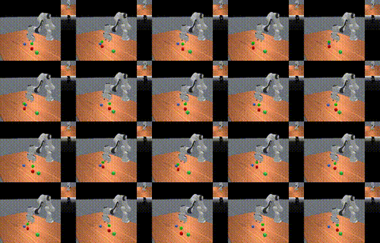

# RLinf + ManiSkill: Three-Cube Picking

Training a **Franka Panda** robot to grasp and lift a **red cube** while **green and blue cubes** act as distractors. Built on [RLinf](https://github.com/RLinf/RLinf) and [ManiSkill](https://maniskill.readthedocs.io/) using **SAC-Flow**. The project demonstrates reinforcement learning for target-specific robotic manipulation.

## Keyboard Teleoperation

ManiSkill-based keyboard teleoperation for controlling the Franka Panda in a three-cube environment, featuring an HD external view, wrist-mounted camera, and gripper control.

**Run:**

```bash
PYTHONPATH="$PWD" python scripts/control_franka.py
```

**Controls:** `W/A/S/D/R/F` for movement, `I/J/K/L/U/O` for rotation, `Z/X` for wrist twist, `SPACE` for gripper, `C` to toggle wrist camera, and `Q` to reset.

## Demo

### Successful red-cube pick

<div align="center">
  <a href="docs/media/success.mp4">
    
  </a>
  <p><em>Successful red-cube picking in ManiSkill. Click to watch the full MP4.</em></p>
</div>

[Watch the full successful rollout (MP4)](docs/media/success.mp4)

### Failure: red cube dropped

The failure-tracking evaluation recorded **one episode where the red cube was grasped and lifted but was no longer grasped at episode end**. Its video was **not captured among the five available evaluation recordings**, so no failure clip is linked yet. We'll add a verified failure video when available, rather than showing an unrelated rollout.

## Experiment

| Component | Configuration |
|---|---|
| Simulator | ManiSkill (SAPIEN / PhysX) |
| Robot | Franka Panda |
| Algorithm | RLinf SAC-Flow |
| Environment | `PickRedCube3-v1` |
| Target | Red cube; green and blue are distractors |
| Observations | Robot and object states |
| Training | 8,000 steps (~3 h 50 min) |
| GPU | NVIDIA RTX 4070 Ti SUPER |

**Scope:** The policy receives state information; this is **not yet vision-based color recognition**. The distractor locations are relatively constrained.

## Results

Independent evaluation of the step-8000 checkpoint:

| Evaluation | Success at least once | Success at episode end |
|---|---:|---:|
| Seed 1000 (100 episodes) | 95% | 90% |
| Seed 2000 (100 episodes) | **100%** | **99%** |

The seed-2000 failure tracker reported:

| Failure category | Episodes |
|---|---:|
| Missed red grasp | 0 |
| Wrong-cube grasp | 0 |
| Red cube dropped | **1** |
| Failed lift | 0 |

These results are from simulation, not physical robot deployment. Reaching the success condition once does not necessarily mean maintaining it until episode end.

## Run

From the project directory, with dependencies installed:

```bash
source .venv/bin/activate
bash run_red_cube3.sh
```

To evaluate a saved checkpoint **without training**:

```bash
bash evaluate_red_cube3.sh
```

The current evaluation launcher points to the checkpoint from the October 15 experiment. Update its checkpoint path when evaluating another run.

Monitor training metrics with:

```bash
tensorboard --logdir logs --port 6006
```

## Key files

| File | Purpose |
|---|---|
| `custom_envs/pick_red_cube3.py` | Three-cube environment and reward |
| `run_red_cube3.sh` | Training launcher |
| `evaluate_red_cube3.sh` | Evaluation-only launcher |
| `summarize_red_cube_failures.py` | Failure analysis |
| `examples/embodiment/config/maniskill_sac_flow_red_cube3.yaml` | SAC-Flow configuration |
| `examples/embodiment/config/env/maniskill_pick_red_cube3.yaml` | ManiSkill environment configuration |

## Next steps

- Capture the actual dropped-cube failure on video.
- Evaluate with all three cube positions fully randomized.
- Extend from privileged state observations to RGB input.
