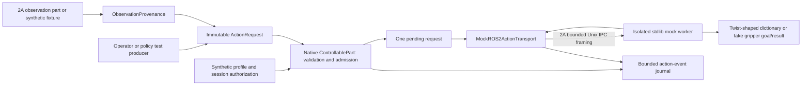

# Milestone 2B.2 — FR3 ROS 2 Action Adapter, Offline Implementation

Exercise typed FR3 and Robotiq actions through native RLinf parts and a local
subprocess mock. The adapter validates normalized requests, binds them to a
synthetic approval/session and observation snapshot, records their dispositions,
and simulates submission and goal results. **It is not authorized for robot
execution and contains no live command transport.**

This milestone uses the fresh branch at baseline `4fef6ac2` and the completed
[Milestone 1 audit](milestone_1_hardware_interface_audit.md),
[Milestone 2A observation report](milestone_2a_ros2_observation_adapter.md), and
[Milestone 2B.1 action/safety audit](milestone_2b1_action_safety_contract.md).
No previous experimental branch was inspected or reused. An AI assistant performed
the implementation and offline verification for the human submitter on 2026-11-19.
The required open upstream PR/issue search for `FR3 offline ROS2 action` returned
no matches. This milestone made no NUC connection or deployment change.

## 1. Architecture and Responsibilities

The native robot tree owns the lifecycle. Action parts use existing observation
snapshots without opening, duplicating, or taking ownership of an observation
connection. The only executable destination is a private local fake worker.



`FR3OfflineAction` and `RobotiqOfflineAction` subclass `ControllablePart`, inheriting
native deferred `Connection.connect()`/`disconnect()` and composing directly with
`FrankaRobot`/`PartGroup`. They are not registered arm/gripper backends. They do not
claim `BaseArm`'s full measured state or `BaseGripper`'s calibrated metre-width
contract. `FrankaEnv`, `ActionKind`, task transformations, and collection code are
unchanged; existing pose/joint/width command paths cannot silently select this
transport.

The subprocess uses the current Python interpreter with `-I -S`: environment/cwd
imports and site startup hooks are excluded. It imports the sibling 2A protocol
helper and the standard library, without loading ROS, an SDK, or RLinf's runtime.
This preserves the proven local process boundary and packet framing while keeping
the ROS-compatible 2A subscriber worker entirely read-only. Python ABI compatibility
with Jazzy or Humble is irrelevant to the mock because it imports neither.

| File | Responsibility |
|---|---|
| [`ros2_offline_action.py`](../../rlinf/robotics/parts/ros2_offline_action.py) | Two concrete native parts; session/authorization, single pending slot, local lifecycle, readiness checks and bounded event journal. |
| [`action_contract.py`](../../rlinf/robotics/parts/transports/ros2/action_contract.py) | Frozen action/interface/observation/profile/authorization types, clock identities, reusable approval/action validation, numeric serialization and dispositions. |
| [`mock_action.py`](../../rlinf/robotics/parts/transports/ros2/mock_action.py) | Owns only the fixed stdlib subprocess and private Unix socket; startup rollback, wall-time IPC bounds and process reaping. |
| [`mock_action_worker.py`](../../rlinf/robotics/parts/transports/ros2/mock_action_worker.py) | One fake endpoint session, one outstanding mock request, wire-shaped dictionaries and deterministic failure/result scenarios. |
| [`test_robotics.py`](../../tests/unit_tests/test_robotics.py) | Focused action cases and integration against the unchanged 2A fake-SDK observation path, alongside native robotics regressions. |
| This report | Public schema, lifecycle, limitations, test commands and results. |

The existing 2A observation parts, transport, worker, and protocol are unchanged.
The new transport imports their bounded `send_packet()`/`receive_packet()` helpers;
it adds no action operation to the observation worker.

## 2. Action Schemas and Explicit Semantics

Select the action kind before constructing a request. The native field name and
its discriminator must both match the receiving part.

| Part | Native Action Mapping | Kind | Payload |
|---|---|---|---|
| `FR3OfflineAction` | `{"normalized_pose_offset": request}` | `fr3_normalized_pose_offset_v1` | Exactly six finite real values in a tuple; channel representation range `[-1,1]`, further restricted by the explicit synthetic profile. |
| `RobotiqOfflineAction` | `{"normalized_closure": request}` | `robotiq_normalized_closure_v1` | Exactly one finite real value in a tuple, restricted to `[0,1]` and the synthetic profile. Zero requests open; one requests closed. |

Booleans, strings, complex numbers, non-finite values, wrong dimensions, and mutable
list payloads are rejected. Finite numeric-array real scalars can be serialized
without changing their numerical value. There is no silent clipping. Generic
`tcp_pose`, `joint_position`, `target`, or width actions fail at the native field
boundary, before submission.

### FR3 Interface Identity

The frozen `InterfaceIdentity` pins the expected mock controller/configuration and
these audited semantics:

| Property | Value |
|---|---|
| Endpoint | `mock://fr3/twist`; a local model identifier, not a ROS topic |
| Units/reference | Dimensionless input, offsets relative to measured forward kinematics |
| Translation | Full scale 0.007 m per channel; inverse mounting rotation into the chain's `base` |
| Rotation | Full scale 0.03 rad per RPY argument; right-multiplied in measured `fr3_link8` orientation |
| Controlled link | `fr3_link8` |
| Mounting RPY | `(0,0,0)`, matching the audited deployment; alternate mounting semantics require a separately reviewed contract |

The worker copies the normalized values into a dictionary with `linear.x/y/z`
and `angular.x/y/z`. It does not multiply them into velocities, solve IK, integrate
motion, track an absolute pose, or model robot dynamics. Keeping scales and frames
in the identity preserves meaning without implementing a pose-to-Twist converter.

### Robotiq Interface Identity

`mock://robotiq/gripper` models an absolute normalized closure request. It is not
raw knuckle radians, physical jaw width, a grasp-success assertion, or force
control. The wire-shaped goal dictionary contains
`command.position = closure` and `command.max_effort = 0.0`. The latter is a fixed
**mock schema placeholder**, not an approved force, a physical zero-force claim,
or a proposed value to send to the real server.

Mock results use normalized position, `effort=None`, and
`physical_grasp_success=None`. A mock completed/reached-goal result only describes
the endpoint model. Milestone 2B.1's real effort-path and width-calibration blockers
remain unresolved.

### Common Request Metadata

`ActionRequest` is frozen. Its requested disposition remains `created`; lifecycle
changes are separate journal events, so callers cannot forge admission by changing
a status field.

| Field | Meaning |
|---|---|
| `schema_version`, `kind`, `disposition` | Version 1, one supported kind, and `ActionState.CREATED`. |
| `values` | Exact immutable normalized tuple for the selected kind. |
| `source_id` | Source bound to the current mock authorization. |
| `session_id`, `authority_id` | Two fresh opaque IDs generated on each successful connection attempt; authorization and requests must match the current epoch. |
| `sequence` | Positive signed-64-bit integer, excluding bool; strictly greater than this session's last admitted sequence. One source is authorized at a time, so no growing per-source replay map is needed. |
| `generated_ns`, `deadline_ns` | Signed-64-bit nanosecond integers: nonnegative generation time and later deadline in the declared local clock; age/lifetime must fit the profile and deadline must not exceed authorization expiry. This is a software serialization bound, not a physical limit. |
| `clock_domain` | Opaque local monotonic clock identity. It must match the part, authorization, and observation provenance. |
| `interface` | Exact expected controller/configuration, kind, endpoint, units, scales, frames, control point and composition semantics. |
| `observation` | `ObservationProvenance`: copied 2A JSON snapshot, explicit local clock identity and timing-uncertainty bound. |

A controller/configuration ID is an explicitly pinned **synthetic identity** here,
not evidence of a current NUC binary. Mock status must report the same identity;
the identity-drift scenario tests rejection. No production fingerprint check or
hardware readiness qualification is claimed.

## 3. Validation and Admission

Connection alone cannot admit an action. Call `arm_mock(profile, authorization)`
with explicit `MockLimitProfile` and `MockAuthorization` objects, then submit a
request belonging to that session/source/clock. Scope must be
`offline_synthetic`; a hardware/live scope is rejected.

The profile requires nonempty profile, approval and calibration IDs; the exact
interface; ordered finite per-channel lower/upper bounds inside the representation
range; positive action-age, lifetime, observation-age, acknowledgement-timeout and
result-timeout bounds; and nonnegative skew/uncertainty bounds. There are no default
numeric limits or default calibration/approval IDs. Authorization requires its own
ID, source, current session/authority, profile ID, clock identity, and future expiry.

These IDs are synthetic test evidence, not authenticated operator permissions or
physical safety approval. A missing profile, calibration, limit, authorization,
identity match, or timing condition prevents **mock** admission. There is no path
from synthetic approval to robot execution.

Admission checks the action schema/type, exact payload shape, finite numbers,
profile range, sequence, source/session/authority, clock, generation age, expiry,
and interface compatibility. It also validates the supplied 2A snapshot:

- Snapshot size is at most 16 KiB; JSON must be valid and finite.
- Complete/bridge-alive flags, selected stream presence, topic/type/domain metadata,
  sequence, connection/error state, source headers and measured-data presence must
  agree with the selected 2A profile.
- Every receipt time must be non-future and within the synthetic observation-age
  bound. Cross-stream receipt skew and the supplied timing uncertainty must fit
  the profile.
- ROS `sec`/`nanosec` and frame IDs are preserved; ROS source stamps are never
  subtracted from a monotonic timestamp. Measurement decoding and dimensional
  validity remain owned by the unchanged 2A observation layer.

`ObservationProvenance.from_observation()` freezes a supplied snapshot; it neither
opens hardware nor establishes that a caller-supplied clock tag is truthful.
The caller must use observations whose receipt times belong to the declared local
clock. Cross-host receipt times require a future explicit clock-domain conversion
and uncertainty contract; relabeling a remote snapshot is not a valid conversion.
The test suite uses synthetic observations or actual 2A code running against its
external fake ROS SDK.

`queue_action()` records creation/validation/admission and consumes the sequence.
`submit_pending()` revalidates time, authorization, observation freshness, identity,
and ownership immediately before IPC. A request admitted earlier can therefore
expire or become inadmissible without being submitted. A failed submission still
consumes its admitted sequence. Reset/re-authorization does not reset the high-water
mark; only a new connection session does, and old-epoch requests remain invalid.
The mock submission also carries a derived admission deadline: the earliest of
request expiry, authorization expiry, source-age expiry and observation-age expiry.
The endpoint checks that bound against logical submission time before retaining
a wire representation, covering delay between local validation and submission.
This admission window is distinct from an already-submitted goal's lifetime.

`ActionRejected` includes a stable `code` and descriptive exception message.
Admission failures record rejection, clear pending requests, and disarm the part;
any outstanding mock request is canceled or reported failed if cancellation cannot
be confirmed over IPC. A submission failure/timeout or readiness/identity conflict
also fails closed. Nothing is silently clipped, retried, replayed, or recovered.

## 4. Mock Transport and Lifecycle

One parent-side lock serializes admission, submission, polling, reset, and cleanup.
There is one pending request and one outstanding mock request per part. Replacing
an unsubmitted pending request records cancellation. A newly submitted request can
preempt the previous outstanding mock request, with its old sequence recorded.
There is no FIFO backlog of stale actions.

Fail-closed admission is per part. Native multi-part dispatch is not an atomic
transaction: one part can simulate submission before another part rejects its
request. A caller handling a compound-action exception must explicitly disarm all
participating parts (for example, `robot.reset()` in this mock-only composition).
The regression suite covers this partial-failure case; the implementation does
not change native dispatch or claim coordinated physical stopping.

```text
created -> validated -> admitted -> submitted
   |            |          |            |
rejected     replaced    expired    acceptance_unknown (FR3/drop)
                                           or mock_acknowledged (gripper)
                                                  |
                                mock_completed / failed / expired / mock_canceled
```

| Operation | Public Behavior |
|---|---|
| Construct part / compose `FrankaRobot` | Records settings; opens no transport or device. |
| `connect()` | Starts the stdlib fake worker, pins interface/session identity and leaves the part disarmed. Native repeated-connect semantics apply. |
| `arm_mock(profile, authorization)` | Checks explicit synthetic approval and consistent, conflict-free mock readiness. Replacing an existing authorization requires reset/disarm first. |
| `queue_action(request)` | Admits to the single pending slot and returns a local snapshot; no submission yet. |
| `submit_pending()` | Revalidates, simulates wire submission, and returns a local snapshot. |
| `send_action({field: request})` | Performs admission and mock submission under one lock. Returns the typed request and explicitly named `mock_disposition`; it never promises physical execution. |
| `poll()` / `get_state()` / `get_observation()` | Evaluates mock readiness, authorization/deadline expiry and outstanding result/timeout state; returns local lifecycle plus the associated historical measured snapshot. Native per-owner snapshot reads are reused. |
| `events()` | Returns copied schema-1 journal records; caller mutation cannot alter retained records. |
| `configure_mock_behavior(name, delay_ns=...)` | Selects a fixed fake failure/delay scenario; it cannot configure a ROS endpoint/domain or live transport. |
| `reset()` | Disarms, discards pending requests and cancels only simulated outstanding work; sends no reset/recovery/activation/reposition command. |
| `disconnect()` | Disarms, closes IPC and reaps only the owned mock worker. It is idempotent. Reconnect creates fresh session and authority IDs and never replays pending work. |

The transport shares 2A's private Unix `SOCK_SEQPACKET` framing, protocol version 1,
and 64 KiB packet cap. It does not use an IP socket. A handshake explicitly reports
`offline=true` and `ros_domain_id=null`. ROS/RMW/DDS environment settings are removed
from the child environment, and the child accepts only its inherited IPC file
descriptor. There is no domain argument, ROS setup script, action-client SDK,
production factory, live flag, or environment-variable bypass. Incorrect endpoint
configuration fails worker startup and rolls back the socket/process.

Startup and each IPC exchange have a configurable positive wall-time timeout,
default one second. Any EOF, malformed/version-mismatched packet, missing worker,
or IPC timeout invalidates the connection and disarms its part. Graceful shutdown
is followed by bounded wait/terminate/kill/reap fallback for an unresponsive fake.
Worker EOF exits the child. Stderr is discarded, preventing a growing diagnostic
buffer; structured failures are returned through the parent journal.
After a failed worker/IPC session, explicitly disconnect and connect again; the
native open-handle contract does not automatically restart a failed worker on a
repeated `connect()` call.

### Deterministic Scenarios and Timing Limits

`ManualClock` provides an opaque per-instance clock domain and explicit
`advance(duration_ns)`. Normal runs can use `MonotonicClock`, whose identity is
local to the current process. Mock endpoint time advances only when the parent
passes logical time in an IPC operation; result-delay/expiry tests need no sleep.
IPC hangs/startup timeouts use real wall time separately.

Fixed scenarios cover normal results, dropped downstream mock delivery, endpoint
rejection/failure, competing-command preemption, ownership conflict, identity
drift, inconsistent readiness, worker crash, malformed IPC and a hung worker.
A scenario never calls a real ROS endpoint. Dropped delivery still records a
local submission attempt; the gripper remains acceptance-unknown and reaches its
mock acknowledgement timeout. The default arm stays acceptance-unknown until
expiry/cancellation/failure, preserving the absence of a legacy controller ack.

The gripper normally acknowledges in the mock response and completes when logical
time reaches its configured result delay. Acknowledgement/result waits have
separate synthetic profile timeouts, and request/authorization expiry is enforced.
Polling after an allowed wait has elapsed conservatively reports failure rather
than treating a late result as timely. Mock completion is not grasp success.

This is a request-driven endpoint model, not a real-time controller simulator.
There is no autonomous publishing loop. Logical-time expiry does not demonstrate
an independent physical watchdog or a wall-clock source-action lease after parent
failure. A live worker would require a separately qualified autonomous source lease;
this worker can only retain or discard dictionaries, even if its parent stalls.

## 5. Action Provenance and Bounded Logging

Every retained event identifies its stage without mutating the requested action.
The journal has a stable schema and is suitable for a later recorder adapter,
while collection and dataset formats remain unchanged now.

| Event Field | Meaning |
|---|---|
| `schema_version`, `event_index` | Version 1 and strictly increasing local event number. |
| `timestamp_ns`, `clock_domain` | Local event time and its explicit monotonic clock identity. |
| `offline`, `physical_execution` | Always `true` and `false`, respectively. |
| `state`, `reason` | Requested/validated/rejected/admitted/submitted/mock-result disposition and stable failure/cancellation reason. |
| `request` | Immutable JSON copy of the action, source, session/authority, sequence, deadline, interface and complete observation provenance. |
| `requested_preview` | Bounded diagnostic preview when malformed input cannot safely be represented as a complete request. It does not replace the full valid request at admitted stages. |
| `approval` | The synthetic profile, limits, calibration ID, and authorization in effect for the event; preserved through terminal/cancellation events. |
| `detail` | Submitted mock wire representation and effective admission deadline, or returned mock result, where applicable. |

The default journal retains 128 events, configurable from 1 to 4096.
`events_evicted` makes retention loss explicit. Valid requests are capped at
32 KiB; invalid previews at 1024 characters. The worker retains only its last wire
representation and one outstanding request, with no unbounded command/result
history. A capacity-limited journal is not a durable dataset recorder.

The `measured` value in a part's observation is the snapshot associated with the
last admitted action, not a continuously refreshed measurement or a claim that
it is still fresh now. Source headers/frame IDs and local receipt times remain in
that snapshot. Only a fresh snapshot can pass the next admission check.

## 6. Native Composition and Offline Test Commands

Use direct native composition for the mock action parts. Do not route them through
`FrankaEnv` or a production backend registry. A construction-only example is:

```python
from rlinf.robotics import FrankaRobot
from rlinf.robotics.parts.ros2_offline_action import (
    FR3OfflineAction,
    RobotiqOfflineAction,
)

robot = FrankaRobot(
    arm=FR3OfflineAction(),
    end_effector=RobotiqOfflineAction(),
)
try:
    robot.connect()  # Starts only local stdlib fake workers; both parts are disarmed.
    status = robot.get_observation()
finally:
    robot.disconnect()
```

`connect()` returns with no action admitted. An offline caller obtains each part's
`session_id`, `authority_id`, `clock.domain`, and `interface`, constructs an explicit
synthetic `MockLimitProfile`/`MockAuthorization`, and calls `arm_mock()`. It freezes
a supplied 2A observation using `ObservationProvenance.from_observation()`, builds
an `ActionRequest`, and calls `robot.send_action()` with the appropriate namespaced
field. The tests' `_offline_approval`, `_offline_request` and synthetic observation
fixtures demonstrate that complete request/approval workflow; none is a hardware
safety profile. Existing 2A parts can sit alongside these parts as independent
observation owners; the action adapter never connects them automatically.

From the repository root, run the focused cases and 2A regression cases:

```bash
PYTHONPATH="$PWD:$PWD/tests/unit_tests" \
  pytest -q tests/unit_tests/test_robotics.py \
  -k 'offline_action or ros2_observation' --disable-warnings --tb=short
```

This selects the offline action tests and the existing ROS observation tests.
Observation tests use the fake ROS SDK; no live graph or robot is contacted.
Local inherited Unix sockets must be permitted by the test environment.

Run the broader CPU robotics suite, excluding scheduler placement, with:

```bash
PYTHONPATH="$PWD:$PWD/tests/unit_tests" \
  pytest -q tests/unit_tests/test_robotics.py \
  -m 'not placement' --disable-warnings --tb=short
```

This exercises the native robotics contracts and all 2A/2B.2 cases on CPU.
No `ray stop`, hardware environment, NUC command, ROS action goal, or physical
qualification procedure is part of either command.

## 7. Verification Results

Checks use the existing RLinf Python 3.11 environment on the workstation CPU.
The eight scheduler placement cases are outside this milestone's offline scope.
The requested Markdown report is outside the EN/ZH Sphinx trees; their existing
FR3 guides remain unchanged and are checked for regression/parity.

| Check | Result |
|---|---|
| Robotics CPU regression (`-m 'not placement'`) | **413 passed, 8 deselected**, 39.43 s. Includes all 27 existing 2A observation cases and 94 action cases. |
| Final focused action run (`-k offline_action`) | **96 passed, 327 deselected**, 8.95 s, after final signed-64-bit timing/profile and submission-window hardening. These changes affect only the new action code. |
| Ruff `check --preview` on all changed Python files | Passed. |
| Ruff `format --check` on all changed Python files | Passed. |
| `tests/unit_tests/check_missing_init.py` | Passed; new modules use the existing ROS 2 transport package. |
| EN/ZH `build_docs.py` gate | Both languages: zero warnings under the repository harness's default autodoc-import filtering. |
| Existing EN/ZH FR3 guide markup and symbol checks | Passed; independently verified live names `fr3_joint1`, `fr3_joint7`, and `fr3_link2` allowed by the symbol checker. |
| Report/native symbol links, Markdown structure, and example syntax | Checked against the implementation; standalone report rendered for inspection. |
| Git whitespace, staged diff and change scope | Report, four new action modules, and component tests only; 2A sources unchanged. |

The 96 action cases cover both representations and full protocol bounds under an
explicit synthetic profile, schema/dimension/type/range failures, numeric-array
scalars, NaN/infinity/oversized integers, replay/order/session rejection,
source/authorization/deadline checks, missing/invalid approval and calibration,
stale/future/skewed or contradictory observation metadata, clock mismatch and
uncertainty, readiness/ownership/identity conflict, queued expiry/replacement,
mock wire formats, admission-window expiry between validation and submission,
delayed/dropped results, timeouts, preemption, endpoint
rejection/failure, worker crash/EOF/IPC hang, startup rollback, reconnect/reset,
bounded journals and immutable approval provenance, native multi-part partial
failure, and the absence of live ROS imports/configuration or automatic commands.
No final test failed. No scheduler placement, accelerator, physical-action,
real-world collection, or hardware qualification test was run.

No doc-code or EN-ZH consistency issues found in checked scope. No CI workflow or
path-filter file exists in this fresh checkout, so there is no filter to extend.
The commit uses the configured human identity and signoff, with subject
`feat(fr3): implement offline ROS2 action adapter`; its SHA and remote verification
are provided in the completion message.

## 8. Unsupported Operations and Remaining Blockers

The implemented transport is permanently a local mock. It cannot publish a Twist,
construct a ROS action client, select domain 70/71, use a serial/FCI connection,
activate/recover/switch controllers, change gains/limits, release or reposition a
robot, start collection, or run a physical policy. No option can turn it into a
live transport. A `mock_completed` disposition and a synthetic approval never
constitute permission for robot execution.

Physical integration still requires the Milestone 2B.1 blockers to be resolved:

- Qualified relationship among `base`, `base_link`, `fr3_link8`, measured `O_T_EE`,
  mounted gripper and task TCP, including axis/orientation conventions.
- Cell-approved workspace, joint margins, dynamics, payload, collision and emergency
  procedures; a software channel range is not a hardware safety limit.
- Calibrated gripper opening/profile/contact behavior and a verified/corrected force
  path. Neither normalized closure nor raw angle is calibrated jaw width.
- Enforceable command ownership/handover, including the current cross-domain bridge,
  and consistent hardware/controller/fault readiness.
- Bounded end-to-end source age, observation freshness/skew, clock uncertainty,
  scheduling/network delays, and independent source-action lease under failure.
- A separately reviewed transport/controller contract for acceptance telemetry,
  retained goals, timeout/stop behavior, preemption and loss; admitted/submitted
  actions remain distinct from physical execution.
- Explicit operator authorization and a separately approved physical-test plan
  before any real command, including a neutral Twist or gripper cancellation.

A suitable next milestone is an operator-reviewed qualification plan plus passive
readiness/calibration evidence, resolving these blockers before proposing any live
command path. This implementation does not start that work automatically.
