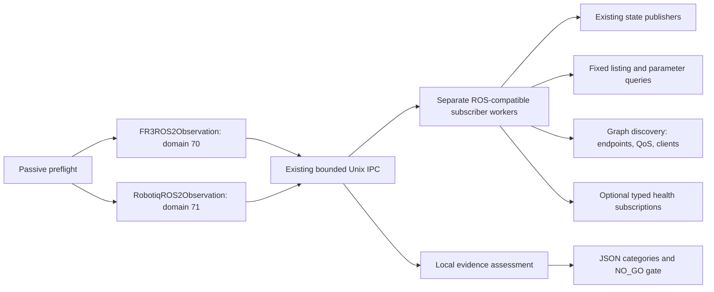

# Milestone 2C — Passive Readiness and Qualification Planning

Assess FR3 and Robotiq observations and controller visibility without acquiring
command authority. The preflight produces separate evidence categories and a
formal **NO_GO** for physical execution. Use this report to identify the passive
integration gaps, then use the [qualification plan](fr3_physical_qualification_plan.md)
to assign the remaining calibration, safety, timing, and operator reviews.

This work uses `branch-openpi-recap-franka-fresh` at baseline `737a1562`, following
[Milestone 1](milestone_1_hardware_interface_audit.md),
[Milestone 2A](milestone_2a_ros2_observation_adapter.md),
[Milestone 2B.1](milestone_2b1_action_safety_contract.md), and
[Milestone 2B.2](milestone_2b2_ros2_action_adapter.md). No previous experimental
branch was inspected or reused. An AI assistant performed this implementation
and passive inspection for the human submitter on **2026-11-19 UTC**. The required
open upstream PR/issue search for `FR3 readiness` returned no matches.

**Follow-up:** [Milestone 2D](milestone_2d_passive_readiness_gaps.md) identifies
frozen Franka device time despite fresh ROS headers and provides a source-supported
explanation of the hardware/controller status divergence. The receipt-fresh PASS
in this historical 2C snapshot does not establish device-measurement validity.

## 1. Evidence and Architecture

Separate what the software reports from what an operator has physically
qualified. The classifications below apply throughout this report and the plan.

| Classification | Meaning |
|---|---|
| **Verified runtime** | Current bounded subscriptions, read-only queries, graph discovery, clock status or process/file metadata. A snapshot can contain conflicting reports. |
| **Source-supported** | Behavior established in the fresh implementation, installed message definitions, or the completed 2B.1 source audit. It has not been exercised by a physical command. |
| **Proposed** | A future requirement or review process, requiring responsible operator acceptance. |
| **Unverified / blocked** | Missing, inconsistent, inaccessible, or dependent on separately authorized physical verification. |

The CLI owns two existing observation parts, which retain their native
`Connection` lifecycle. It extends their worker with a fixed read-only diagnostic
request. The action contracts, mock transport, `FrankaEnv`, task dispatch, and
collection code remain unchanged.



The RLinf process uses Python 3.11; workstation workers use system Python 3.12
and Jazzy. NUC-side passive verification uses existing Python/Humble interfaces.
Monotonic timestamps from those hosts are never compared. No `rclpy` package was
installed into the RLinf environment.

| File | Responsibility |
|---|---|
| [`ros2_readiness.py`](../../rlinf/robotics/parts/ros2_readiness.py) | Bounded two-domain orchestration, fixed expected interface/configuration subset, freshness and contradiction checks, seven categories and unconditional physical denial. |
| [`passive.py`](../../rlinf/robotics/parts/transports/ros2/passive.py) | ROS-worker-only collection of whitelisted services, graph endpoints and latest typed health. Imports ROS only inside the collection function. |
| [`ros2_observation.py`](../../rlinf/robotics/parts/ros2_observation.py) | Public connected-part `inspect_status(budget)` method. |
| [`observation.py`](../../rlinf/robotics/parts/transports/ros2/observation.py), [`worker.py`](../../rlinf/robotics/parts/transports/ros2/worker.py) | Reuse existing subprocess ownership, IPC framing and teardown for the additional read-only request. |
| [`fr3_readiness_preflight.py`](../../toolkits/realworld_check/fr3_readiness_preflight.py) | CLI, JSON output and evidence-oriented exit status. |
| [`ros2.py`](../../tests/robot_mocks/ros2.py), [`test_robotics.py`](../../tests/unit_tests/test_robotics.py) | Restricted external ROS SDK fake, readiness cases and full robotics regressions. |
| This report and [qualification plan](fr3_physical_qualification_plan.md) | Evidence, limitations, acceptance records and future responsibilities. |

## 2. Running the Passive Preflight

Run the utility from the fresh repository to attach to existing state publishers
and inspect read-only status. Domains are fixed at 70 and 71; there is no command
or authorization option.

```bash
PYTHONPATH="$PWD" python toolkits/realworld_check/fr3_readiness_preflight.py \
  --duration 3 --budget 3 --timeout 8 \
  --ros-python /usr/bin/python3 \
  --ros-setup /opt/ros/jazzy/setup.bash \
  --output /tmp/fr3_readiness.json
```

The utility starts only its own observation workers, allows three seconds for
state discovery, and concurrently collects diagnostics within a three-second
response window per domain. It then reads current observations and releases its
own subscriptions, diagnostic clients, sockets, processes, and temporary logs.
Without `--output`, it writes JSON to stdout. It never constructs `FrankaEnv`,
opens a device SDK/serial connection, starts cameras/input acquisition, or modifies
external controllers or the existing bridge.

`--duration` is in `(0,30]` seconds; `--budget` is in `(0,5]`; `--timeout` must be
at least budget + 0.5 s and at most 30 s. Startup and each IPC request are bounded
by the timeout, with the existing finite termination/reaping fallback. These are
software timeout settings, not real-time scheduling guarantees or approved
control-age limits. A hung collector becomes explicit partial/error evidence.

Exit **0** means all six passive categories passed; **1** means at least one
failed; **2** means at least one is unknown and none failed. Invalid CLI input
also uses argparse exit 2 with an error message. All successful JSON assessments,
including exit 0, contain:

```json
{
  "schema": "fr3_passive_readiness_v1",
  "physical_command_authorization": "NOT_GRANTED",
  "qualification_gate": "NO_GO"
}
```

The physical category is always `NOT_QUALIFIED`. No input report, profile,
environment variable, or CLI setting can turn this utility into an action path.
The JSON is an assessment artifact, not an authorization token for 2B.2.

### Collected Interfaces and Bounds

The diagnostic worker only creates clients for these read-only services:

- `/controller_manager/list_controllers`
- `/controller_manager/list_hardware_components`
- `/controller_manager/list_hardware_interfaces`
- `/controller_manager/get_parameters`
- `/joint_impedance_ik_controller/get_parameters` on domain 70
- `/robotiq_gripper_controller/get_parameters` on domain 71

It requests a fixed parameter subset. It records a canonical JSON SHA-256 of that
subset, preserving reported types. The digest is a drift identifier, not running
binary attestation or a safety approval. Expected values match the 2B.1 audit;
missing values are `UNKNOWN`, changes are `FAIL`, and the tool never writes them.

Existing 2A state streams retain latest-only samples and best-effort/volatile
keep-last-5 subscriptions. During diagnostics the same executor continues state
callbacks. Temporary optional health readers use that same QoS and retain one
sample. The optional topics are `/franka_robot_state_broadcaster/robot_state`
(`franka_msgs/msg/FrankaRobotState`) and
`/robotiq_gripper_status_broadcaster/status` (`robotiq_msgs/msg/GripperStatus`).
Missing custom types remain explicit. Typed health is separate diagnostic evidence;
the 2A state schema and its `unavailable_fields` contract are preserved.

Graph discovery inspects the arm Twist subscription, bridge input subscription,
state publishers, both gripper action servers, and discovered gripper action-client
identities. It constructs **no action client**. Counts bound evidence to 128 nodes,
32 controllers, 8 hardware components, 128 interfaces per list, 16 endpoints per
topic, and 32 relevant action graph records. Overflow is an explicit collection
error; the 64 KiB IPC packet cap remains enforced. No message history is retained.

## 3. Current Readiness Findings

Current workstation and NUC observations establish usable standard state and
unresolved controller visibility. They do not establish a safe command path.
The final workstation probe completed in **7.631 s**, exited **2**, and captured
assessment wall time `1795079011432658292` ns (2026-11-19 UTC).

| Category | Workstation Result | Interpretation |
|---|---|---|
| Observation readiness | `PASS` | All six selected streams complete, valid, connected and fresh against the inspection threshold 0.25 s; advertised QoS compatible with best-effort/volatile readers. |
| Controller-status visibility | `UNKNOWN` | Controller-manager listing calls timed out and remote manager node identities were absent locally. Typed FR3 health package unavailable. |
| Gripper-status visibility | `UNKNOWN` | Raw/normalized state arrived; custom typed fault package unavailable locally. |
| Interface identity consistency | `UNKNOWN` | Fixed queried parameter values matched; remote subscriber node was `_NODE_NAME_UNKNOWN_`; action-server identities undiscovered locally. |
| Timing evidence availability | `PASS` | ROS headers and same-host receipt ages available; clock-error and latency bounds remain unqualified. |
| Ownership evidence availability | `UNKNOWN` | Local graph cannot establish remote client/server identity completely. Empty discovery is not exclusive ownership. |
| Physical safety qualification | `NOT_QUALIFIED` | Calibration, independent safety evidence, timing/failure qualification and operator approval outstanding. |

A `PASS` applies only to its named evidence category. Any explicit contradiction
wins over `UNKNOWN`/`PASS` within a category. Missing/malformed observations,
wrong domains/types/configuration, stale/future receipts, conflicting claims,
duplicate manager identities, multiple external gripper clients, and multiple
arm publishers are surfaced. Known internal gripper relay clients are recorded
separately from external clients. ROS node names provide discovery identity,
not authentication or a command lease.

### FR3: Current NUC Evidence

**Verified runtime:** Humble domain 70 reports active
`joint_impedance_ik_controller` of type
`franka_arm_controllers/JointImpedanceIKController`, claiming the seven named
`fr3_joint1/effort` through `fr3_joint7/effort` resources. However, both a separate
listing probe and the new collector on the NUC reported
`FrankaHardwareInterface` **unconfigured (state 1)**, with command interfaces
**unavailable and unclaimed**. One manager node was discovered in that NUC sample.

This is a **FAIL for controller-state consistency**, not evidence that the robot
is safely inactive. The 2B.1 audit also recorded inconsistent hardware-list
responses; its later isolated active response does not resolve the current
contradiction. No controller was restarted, switched or recovered to investigate.
The origin and authoritative interpretation of these divergent reports remain
**Unverified / blocked**.

**Verified runtime:** manager 1000 Hz, IK update 50 Hz, timeout 0.25 s,
`use_sim_time=false`, mounting RPY `[0,0,0]`, gains and `arm_id` match 2B.1.
One best-effort/volatile Twist subscription at
`/franka_controller/target_cartesian_velocity_percent` belongs to the expected
controller on the NUC; no publishers were discovered in that snapshot. Discovery
reported depth 0; the prior source audit supports keep-last-1, not an unbounded
queue. No acknowledgement/correlated accepted-target interface was established.

**Verified runtime:** a five-second NUC diagnostic window received typed FR3
status with `robot_mode=2` (the message's `MOVE` enum) and all 36 `current_errors`
flags false. This is source-reported mode/health, not a proof of stationary state,
a safe workspace, or permission to command. Current pose frame is `base`, joint
frame `base_link`, base wrench frame `base`, and stiffness wrench frame
`fr3_link2`. No frame equivalence was assumed.

### Robotiq: Current NUC Evidence

**Verified runtime:** domain 71 reports active
`robotiq_controllers/GripperCommandController`, active hardware state 3, and the
expected raw knuckle position resource available/claimed. The separate maximum
speed/effort setting resources are available but unclaimed. Status, normalized
position, joint-state and activation controllers report active; none was invoked.
Manager rate is 500 Hz and queried controller parameters match 2B.1.

Both `/robotiq_gripper_controller/gripper_cmd` and
`/robotiq_gripper_controller/normalized_gripper_cmd` are discovered NUC-side as
`control_msgs/action/GripperCommand` servers belonging to the gripper controller.
Discovery also identifies the controller's internal raw-action relay client and
external `robotiq_output_domain71` bridge client. Multiple client roles are not
interchangeable with independent operators. Future handover must account for
both raw and normalized entry points and the existing external bridge.

The bridge's domain-70 input subscription remains
`/gripper_client/target_gripper_width_percent`, `std_msgs/msg/Float32`,
reliable/volatile, with no discovered input publishers. **Source-supported (2B.1):**
the bridge can retain a pending request without a source expiry and wait for a
result without a bounded deadline. Its retained state is not visible in graph
discovery. An empty input-publisher graph cannot prove that no future goal is
pending. The bridge was not stopped or modified.

**Verified runtime:** a five-second NUC window yielded typed gripper status:
object detection 3, motor current 0 A, fault 0, severity 0, empty frame identifier.
Unknown fault/severity 255 must remain unknown. Fresh ROS position/status headers
do not establish fresh serial-device measurements during communication loss.
**Source-supported (2B.1):** `max_effort=50` is not verified physical force
limiting in the active position-command path. Contact/stalled/success results do
not independently prove a successful physical grasp.

### Deployment Identity

Read current mapped libraries independently of ROS configuration. **Verified
runtime:** arm manager PID **232045**, domain 70, maps the same installed library
inode 29507291 and build ID `d2a22c4eb68322d90dec5b0863cb3a2b56ea72f0` audited in
2B.1. Its PID differs from the prior audit's 217731; the cause/time of that
external lifecycle change is unknown. This milestone performed no lifecycle action.
Gripper manager PID **11985** remains domain 71; bridge PID **12140** remains
present. Current SHA-256 values are:

| Deployed File | SHA-256 |
|---|---|
| `franka_arm_controllers/lib/libfranka_arm_controllers.so` | `3b16083954f38d020ffa4f8b465056e3bc5a8933f9af9109bfb6c2582e7752b4` |
| `robotiq_controllers/lib/librobotiq_controllers.so` | `0670aee691f29833cc8cafe3eace0eacb7ab2d014e923262f28db04ae6e37a41` |
| `robotiq_driver/lib/librobotiq_driver.so` | `66360abc62d0bd992e2b58dd63fb374bcb9736f447b71094916a2f2b5fd032c6` |
| Current `/tmp/robotiq_cross_domain_bridge.py` file | `c1061fede027d08cfd23349e1d0e3c9f96a8de9c7a43620cb5c058d5d752159e` |

Full deployment roots and source/binary limitations are recorded in
[2B.1](milestone_2b1_action_safety_contract.md#evidence-locations-and-binary-identity).
The current bridge file cannot prove the exact code loaded by a long-running
Python process. Matching controller library hashes do not supply reproducible
build provenance or physical safety qualification. The preflight deliberately
labels binary identity `UNKNOWN`; it does not SSH or attest remote libraries.

## 4. Timing and Synchronization Evidence

Use receipt age for local freshness and preserve source time separately. The
preflight uses `time.monotonic_ns()` from workers and parent on the **same
workstation**, labeled `preflight_host`. NUC-only samples use the NUC monotonic
clock and were reviewed separately, never injected into workstation freshness
checks. ROS headers are acquisition/publication metadata, not the local receipt
clock and not automatically hardware measurement timestamps.

| Final Workstation Sample | Observed Value |
|---|---|
| FR3 local receipt ages | 0.644 ms joints; 1.017 ms pose; 0.933/0.859 ms base/stiffness wrench |
| Gripper local receipt ages | 0.402 ms raw; 0.180 ms normalized |
| Source wall differences | 0.492–3.918 ms across selected streams; unqualified because host clock offset and publisher timing are not bounded |
| FR3 source stamp spread | 2.000 ms |
| Gripper source stamp spread | 2.029 ms |
| Across all selected source stamps | 3.426 ms; latest samples are asynchronous |
| Diagnostic collector duration | 3.003 s per domain, including the configured three-second sampling/query window |
| IPC request round trips | 3.028 s per domain, including that window; not one-way IPC latency |

**Verified runtime:** chrony reported normal leap status and stratum 3 on both
hosts. Workstation RMS offset was about 0.207 ms and system time 66.2 µs fast;
NUC RMS about 0.161 ms and system time 40.1 µs fast. These were different status
snapshots, not a simultaneous host-to-host offset measurement. The CLI reports
clock qualification unknown; it does not query or configure chrony.

**Unverified / blocked:** worst-case inter-host offset, acquisition-to-publication
delay, DDS/network loss/jitter under workload, scheduling delay, IPC maximum
latency, command delivery/acceptance latency and the actual timeout-to-hold
behavior. Short state samples and chrony statistics establish no worst-case bound.
The configured 0.25 s command timeout and 2A inspection freshness default are not
qualified safety budgets. The [plan](fr3_physical_qualification_plan.md) requires
approved limits, measurement uncertainty and failure procedures before any live
integration. No command was published to measure latency.

## 5. Calibration, Ownership, and Safety Gate

Keep geometry, representation and authority unresolved until each has a signed
record. The [qualification plan](fr3_physical_qualification_plan.md) defines the
required frame/TCP and gripper calibrations, accountable operator roles,
acceptance criteria, expiration triggers, failure responsibilities, and go/no-go
record. It contains no executable test or prescribed experimental movement.

**Source-supported:** FR3 six-channel requests are normalized measured-FK pose
offsets, with 0.007 m translation scale and 0.03 rad RPY scale, differing
translation-frame and right-composed rotation semantics. They are neither SI
velocity nor RLinf absolute `tcp_pose`. The offline adapter remains the only
action implementation. No arbitrary pose-to-Twist conversion, calibrated gripper
width mapping or production backend registration was added.

**Proposed:** future authority must be explicitly granted per arm and gripper
session, after handover from existing clients, consistent status, independently
qualified hardware safeguards, calibrated frames/representations, approved timing
and limit profiles, and named operator review. Connection, reset, reconnect and
disconnect must remain disarmed and non-moving. A graph-only exclusive-publisher
check cannot enforce ownership; normalized/raw gripper entry points must share
one authority model. Process death and communication loss must expire source
requests without replay. Faults require operator review, never automatic recovery.

Stopping software publication, retaining a controller reference, protective
stopping, and hardware emergency stopping have different owners and effects.
**Source-supported (2B.1):** arm reference retention continues impedance torque;
gripper goal failure can retain a position target. Neither is a qualified stop.
The plan assigns independent safety functions to the responsible operator and
hardware safety system, not to an RLinf readiness report.

The current formal gate is **NO_GO**: inconsistent arm hardware listings,
incomplete workstation status/ownership visibility, frame/TCP and gripper
calibration, force/contact qualification, independent stop/fault/failure evidence,
qualified timing uncertainty, exclusive handover and explicit operator approval
are outstanding. Offline and passive passes cannot satisfy physical qualification.

## 6. Verification and Change Boundary

Run all CPU robotics regressions from this checkout with the documented placement
exclusion. This exercises the original observation and offline action paths as
well as passive readiness.

```bash
PYTHONPATH="$PWD:$PWD/tests/unit_tests" \
  pytest -q tests/unit_tests/test_robotics.py \
  -m 'not placement' --disable-warnings --tb=short

PYTHONPATH="$PWD:$PWD/tests/unit_tests" \
  pytest -q tests/unit_tests/test_robotics.py \
  -k ros2_readiness --disable-warnings --tb=short
```

The first command includes all 27 observation and 96 offline action cases. The
second isolates the new readiness component. The eight placement tests require
scheduler worker placement and remain excluded as previously documented; no Ray
process was stopped. Hardware, GPU, policy inference and data collection were not
run.

| Validation | Result |
|---|---|
| Baseline CPU robotics | **415 passed, 8 deselected**, 38.88 s, Python 3.11.15, workstation CPU |
| Focused readiness | **41 passed, 423 deselected**, 15.22 s; the additional graph-overflow case also passed in the final full suite (42 readiness cases total) |
| Final CPU robotics | **457 passed, 8 deselected**, 51.80 s; all 27 observation, 96 offline action and 42 readiness cases included |
| Ruff lint/format, package init and diff checks | **PASS**: eight changed Python files linted/formatted; all Python directories have `__init__.py`; `git diff --check` clean |
| Documentation | **PASS**: EN and ZH builds each zero warnings under the repository harness's default autodoc filtering; existing bilingual guide markup/symbol checks pass; both new Markdown pages pass structure, local link/anchor and example syntax checks |

Focused cases cover categories that never authorize, malformed/wrong-domain/
wrong-schema evidence, finite dimensions, stale/future receipts, missing/custom
health types, fault/unknown fault, configuration drift, resource conflicts,
duplicate managers, competing external clients, partial/oversized graph discovery,
worker crash, IPC timeout, reconnect, idempotent cleanup, CLI JSON, and static
absence of command/action operations. The external fake permits only fixed
read-only service clients and state subscriptions. Observation samples continue
advancing while diagnostics spin. It grants no hardware or safety approval.

This checkout has no `.github/workflows/ci-tests.yml` to extend; tests remain in
the existing robotics component file. These requested standalone milestone Markdown
reports are outside the bilingual Sphinx source trees; existing EN/ZH observation
guides remain unchanged and both builds are checked.

**Verified runtime:** all live work was passive: bounded state subscriptions,
listing/parameter reads, graph discovery, installed message/process/library
inspection and clock tracking. No Twist (including zero), action goal/cancel,
controller-changing service, device ownership, camera/input acquisition, or
physical control was introduced or performed.

The recommended next milestone is **operator review and closure of passive
status/identity, calibration and safety-evidence gaps**, followed only under a
new explicit authorization by a separately scoped supervised hardware
qualification. Stop at this report; live action integration and data collection
remain disabled.
