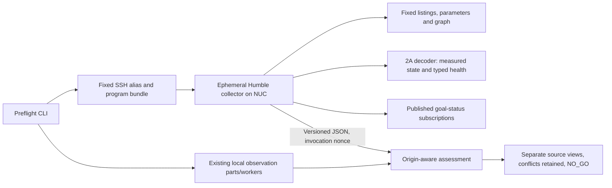

# Milestone 2D — Passive Readiness Gap Resolution

Resolve passive status visibility while retaining genuine controller and
measurement failures. The preflight now combines workstation observations with
bounded, installation-free Humble diagnostics on the NUC. The arm remains
**FAIL**, and physical execution remains **NO_GO / NOT_GRANTED**: its manager
reports unconfigured hardware and continues publishing state whose device time
is frozen. Read this report for the source-supported explanation, interface and
ownership findings, implementation contract, and remaining operator decisions.

**November 20 follow-up:** [Passive recovery revalidation](milestone_2d_recovery_revalidation.md)
records a later controller session with advancing device time. The historical
findings below remain unchanged; physical qualification and command authorization
remain ungranted.

This milestone uses `branch-openpi-recap-franka-fresh` at clean baseline
`00dbe4b652eca1edb2f1a2c4d9d322b34e61f552`. It follows the
[Milestone 1 audit](milestone_1_hardware_interface_audit.md),
[2A observation adapter](milestone_2a_ros2_observation_adapter.md),
[2B.1 action/safety audit](milestone_2b1_action_safety_contract.md),
[2B.2 offline actions](milestone_2b2_ros2_action_adapter.md),
[2C readiness report](milestone_2c_passive_readiness.md), and
[physical qualification plan](fr3_physical_qualification_plan.md).
No previous experimental branch was inspected or reused. An AI assistant
performed the implementation and passive verification for the human submitter
on **2026-11-19 UTC**. The required open upstream PR/issue search for `FR3
readiness` returned no matches.

## 1. Evidence and Current Decision

Use separate evidence levels to interpret the results. Discovery and a configured
active controller do not establish fresh device acquisition or physical safety.

| Classification | Meaning |
|---|---|
| **Verified runtime** | Current read-only queries, subscriptions, installed definitions, process/library metadata and bounded portions of the current manager log. |
| **Source-supported** | Explanation supported by inspected deployed source or official versioned upstream source; no physical response was exercised. |
| **Proposed** | A future integration or operator-review requirement. |
| **Unverified / blocked** | Missing, inconsistent or dependent on separately authorized physical interaction. |

The final merged probe completed in **20.976 s**, exited **1**, and retained all
six NUC snapshots. Its workstation-only categories are preserved separately.
A [versioned audit evidence summary](evidence/milestone_2d_passive_evidence.json)
records origins, clock domains, manager epochs, query timestamps, expected
resource claims, health progression and ownership observations. Observation
payloads are hashed in that summary; unchanged manager records are referenced by
canonical SHA-256. It includes the full JSON report's byte hash
`26756accfa3fc76ef2bcab4b1df6e8910f020d2f6fafc01bca98a386b378544f`.
This summary is an audit artifact, never a runtime admission input.

| Category | Workstation View | Merged View | Meaning |
|---|---|---|---|
| Observation readiness | PASS | **FAIL** | Receipt-fresh standard state is insufficient: NUC evidence shows unconfigured arm hardware and non-advancing Franka device time. |
| Controller-status visibility | UNKNOWN | **FAIL** | Humble queries consistently expose the arm's failed/inconsistent hardware-versus-controller condition. |
| Gripper-status visibility | UNKNOWN | **PASS** | Typed status is readable and receipt-fresh at the NUC snapshot; serial measurement freshness remains unverified. |
| Interface identity consistency | UNKNOWN | **PASS** | Expected types/configuration, single manager provider and stable mapped-library/process identities agree in the captured windows. This is not source-build attestation. |
| Timing evidence availability | PASS | **PASS** | Source, receipt and query timing evidence exists; no qualified clock/latency bound follows. |
| Ownership evidence availability | UNKNOWN | **PASS** | Expected endpoint/client identities are visible; exclusive authority and handover remain ungranted. |
| Physical safety qualification | NOT_QUALIFIED | **NOT_QUALIFIED** | Calibration, independent safeguards, failure qualification and operator approval remain outstanding. |

A passive category's PASS applies to the named evidence scope. It does not mean
that the cell is ready to execute. The returned `qualification_gate` is always
`NO_GO`, and `physical_command_authorization` is always `NOT_GRANTED`.

## 2. Arm Status Contradiction

The discrepancy persists under a stable, identified manager; it must not be
explained away as an unfavorable discovery snapshot. Three independently timed
windows each queried all fixed services and collected measured state plus typed
health on Humble domain 70.

| NUC Snapshot End (UTC) | Manager PID / Start Ticks | Controller | Hardware | Effort Interfaces | Health Samples / Device Time |
|---|---|---|---|---|---|
| 09:45:03.379 | 232045 / 313073028 | active; seven named claims | unconfigured, state 1 | all seven unavailable/unclaimed | 1914 / 86371.383 → 86371.383 s |
| 09:45:05.520 | 232045 / 313073028 | active; same seven claims | unconfigured, state 1 | same unavailable/unclaimed flags | 1997 / unchanged |
| 09:45:07.663 | 232045 / 313073028 | active; same seven claims | unconfigured, state 1 | same unavailable/unclaimed flags | 1997 / unchanged |

**Verified runtime:** manager UID 1000, executable
`/opt/ros/humble/lib/controller_manager/ros2_control_node`, domain 70; one
`/controller_manager` node and one provider per listing service were discovered.
Process identity and mapped-library identities were unchanged before/after every
window and across the sequence. All five query groups responded within their
collector windows. ROS joint/pose/wrench headers advanced, while measured payload
hashes and device time remained unchanged. Joint arrays were decoded by explicit
`fr3_joint1`–`fr3_joint7` names and validated, as in 2A.

Manager parameters remain 1000 Hz, IK 50 Hz, timeout 0.25 s,
`use_sim_time=false`, mounting RPY `[0,0,0]`, with the audited arm ID and gains.
`robot_mode=2` (`MOVE`), all 36 current-error flags false and success rate 1.0 were
**reported in the frozen state**. They cannot establish current physical mode,
current absence of errors, or successful ongoing I/O.

### Source-Supported Explanation

The current manager's own log provides a historical I/O failure at
**08:21:00.770 UTC**, before this milestone's probes:

```text
libfranka: Move command aborted: User Stop pressed!
Franka read failed; further I/O is blocked pending operator review
```

These are short excerpts from
`~/.ros/log/ros2_control_node_232045_1795075170277.log` on the NUC. That same log
records successful hardware configuration/activation during process startup.
This milestone did not cause the stop, restart the manager, recover the error,
or invoke any hardware action. The physical button's current condition is unknown.

**Source-supported:** the inspected current Franka hardware source catches the
read exception, latches `io_error_`, and blocks subsequent I/O. Its last state
storage therefore can remain available to broadcasters. The semantic-component
conversion copies `robot_state_ptr->time.toSec()` into the typed status's `time`
field. The hardware source checkout has local modifications; source/binary
reproducibility is not asserted. The running library contains the observed error
path, and repeated frozen device time corroborates retained acquisition state.

**Source-supported:** official ros2_control **2.54.0** explains how the reported
states can diverge. Controller listings copy cached claims and controller
lifecycle state, while the update path calls resource-manager read/write without
using the returned hardware failure status to revise that listing. See the
[versioned controller-manager source](https://github.com/ros-controls/ros2_control/blob/2.54.0/controller_manager/src/controller_manager.cpp).

A hardware read error invokes the system error transition; a successful error
handler leaves the system unconfigured. In that state, subsequent system reads
skip device I/O. See the
[versioned system lifecycle source](https://github.com/ros-controls/ros2_control/blob/2.54.0/hardware_interface/src/system.cpp).
The resource manager removes failed hardware interfaces from availability, and
its claim query returns false for unavailable interfaces. See the
[versioned resource-manager source](https://github.com/ros-controls/ros2_control/blob/2.54.0/hardware_interface/src/resource_manager.cpp).

**Verified runtime:** installed controller-manager/hardware-interface packages
report 2.54.0 and `dpkg -V` reported no modified package files. Loaded paths match
those installed libraries. This supports the explanation; it is not a physical
test or reproducible build proof. No stale response, manager epoch transition or
competing same-name provider was observed in the bounded sequence. Discovery
limitations cannot explain away the independently consistent NUC results.
The retained controller-active/claimed versus hardware-unavailable condition
remains **FAIL**. Earlier favorable snapshots are not substituted for it.

### Loaded Library Identity

The audit summary preserves full paths, inode/device identifiers and hashes.
Current identity matches the 2C arm-controller deployment while adding hardware
and manager-library evidence:

| Mapped Library | SHA-256 |
|---|---|
| Arm controller | `3b16083954f38d020ffa4f8b465056e3bc5a8933f9af9109bfb6c2582e7752b4` |
| Franka hardware | `26328780995f0a195b18338ad0890bafeb2e0bfc170a2dcd300f76190562b640` |
| ros2_control hardware interface | `16ec4b084f1a515338d7965fd82034d2431ddda7e6ea3ebb899b25efbe8717f8` |
| Controller manager | `5ead8d6c308ddb06aeb1b55370879236ece41f560b324c2cbcd9cb86d0ea0433` |

Manager PID attribution is corroborated by same-UID process/domain inventory,
single graph provider, stable start ticks and loaded files. ROS discovery does
not cryptographically bind a service endpoint to a PID, and inaccessible or
other-UID processes are outside the process inventory. These limits remain
explicit; no host-to-host authenticated command authority is inferred.

## 3. Cross-Distribution Visibility and Health

Use each host's installed interfaces for diagnostics rather than assuming a
matching ROS type name means a matching schema. **Verified runtime:** installed
Jazzy `ControllerState` adds `is_async`, `update_rate` and
`exported_state_interfaces` relative to the inspected Humble definition. Jazzy
`HardwareComponentState` also adds asynchronous/rate/plugin fields absent from
Humble. These structural differences support treating direct cross-distribution
controller-manager calls as incompatible/unqualified; their observed local
failure remains a discovery/response timeout, not a claimed hardware diagnosis.
Standard parameter reads and standard measured state still arrived locally.

The fixed NUC collector uses the installed Humble service definitions and
existing Franka/Robotiq message packages. It returns normal JSON to RLinf without
installing custom types into Jazzy or `rclpy` into the Python 3.11 environment.
All six final NUC snapshots had no listing/parameter collection errors. Local
UNKNOWN findings are preserved under `local_categories`; successful remote
visibility resolves that visibility gap without erasing the arm's real failure.

**Verified runtime:** gripper domain 71 snapshots ended at 09:45:09.705,
09:45:11.835 and 09:45:13.964 UTC, under PID **11985**, start ticks **305445094**.
The expected controller and hardware were active, and raw knuckle position was
available/claimed. The manager reported 500 Hz. Raw/normalized observations were
finite and decoded using their distinct joint names. Typed health yielded
998/999/999 samples, object status 3, motor current 0 A, fault 0 and severity 0.
This is fresh ROS status at the NUC collection time, not a serial-device
acquisition timestamp, calibrated force, or physical grasp verdict.

The gripper controller/driver hashes remain
`0670aee691f29833cc8cafe3eace0eacb7ab2d014e923262f28db04ae6e37a41` and
`66360abc62d0bd992e2b58dd63fb374bcb9736f447b71094916a2f2b5fd032c6`.
The earlier `max_effort` qualification blocker is unchanged.

### Explicit Failure Classification

Machine-readable failure kinds preserve what was actually observed:

| Evidence Failure | Recorded Kind / Interpretation |
|---|---|
| No advertised health topic | `TOPIC_NOT_DISCOVERED`; not proof of a hardware fault |
| Custom message import failed | `MESSAGE_IMPORT_ERROR`; missing definition distinguished from missing publisher |
| Service type import/client construction failed | `SERVICE_TYPE_IMPORT_ERROR` / `CLIENT_CREATION_ERROR` |
| No ready service before deadline | `SERVICE_NOT_DISCOVERED` |
| Request sent but no response before deadline | `RESPONSE_TIMEOUT` |
| QoS compatibility check fails | `QOS_INCOMPATIBLE`; explicit failure, not guessed from silence |
| Defined publisher but no sample | `NO_SAMPLE`; missing evidence, not assumed idle/healthy |
| Wrong type or malformed decoded payload | `INTERFACE_TYPE_MISMATCH` / `INVALID_RESPONSE` |
| Consistent unconfigured hardware / frozen device clock | Readiness `FAIL`; no automatic recovery |
| SSH failure, malformed JSON, nonce/version mismatch or excessive output | Remote error with fail-closed UNKNOWN/FAIL categories; never command authorization |

The compatibility checker uses the installed rclpy API's `(compatibility, reason)`
return contract on Humble/Jazzy. Health values, ROS stamp dimensions, modes,
finite values and gripper fault unknowns are validated. Runtime diagnostics
also preserve endpoint GIDs when exposed. No compatibility claim extends to
uninspected custom messages or future package versions.

## 4. Passive Ownership Inventory

Record visible command paths without granting ownership. The following identities
were visible on the NUC; missing publishers and resource claims provide no lease.

| Domain / Scope | Endpoint / Identity | Passive Finding and Confidence |
|---|---|---|
| 70, arm input | `/franka_controller/target_cartesian_velocity_percent`, `geometry_msgs/msg/Twist` | One expected controller subscriber, best-effort/volatile; zero discovered writers in all captured windows. Runtime graph evidence only. |
| 70, bridge input | `/gripper_client/target_gripper_width_percent`, `std_msgs/msg/Float32` | `spacemouse_input_domain70` subscriber, reliable/volatile; zero discovered input writers. No acquisition process was started. |
| 71, raw gripper server | `/robotiq_gripper_controller/gripper_cmd` | `control_msgs/action/GripperCommand`, expected gripper controller. |
| 71, normalized gripper server | `/robotiq_gripper_controller/normalized_gripper_cmd` | Same action type and controller; distinct normalized closure representation. |
| 71, internal relay | `robotiq_gripper_controller` raw-action client | Controller's normalized-to-raw route, recorded separately from external clients. |
| 71, external bridge | `robotiq_output_domain71` raw-action client | Existing external command source; no handover or modification performed. |
| Other external clients | Both gripper routes | None additionally discovered during these windows; not an exclusive-authority guarantee. |

Read-only subscriptions to both published `/_action/status` topics avoid action
clients entirely. The raw server supplied the same five retained goal records,
all status **4 (`SUCCEEDED`)**, in every window. These are source-reported
historical action dispositions, not verified execution or grasp success.
`GoalStatusArray` has **no header**; per-goal stamps are creation timestamps.
The reader preserves those stamps and local receipt separately and records
publication time as unavailable. The normalized status topic produced no sample;
no idle-state conclusion follows. No executing/accepted goal appeared in the
received raw array, but retained status cannot prove that all current work is
absent. The bridge's pending queue remains **UNKNOWN**. No goals, result
requests, cancellation requests or probe commands were sent.

## 5. Implementation and Timing Contract

The extension keeps the native observation connection and local process boundary.
It adds one fixed SSH collection path, not a remote action framework.



| File | Change |
|---|---|
| [`ros2_readiness.py`](../../rlinf/robotics/parts/ros2_readiness.py) | Per-origin snapshot assessment, frozen device-time and unconfigured-acquisition failure, six-snapshot merge, manager epoch checks and conflict retention. |
| [`passive.py`](../../rlinf/robotics/parts/transports/ros2/passive.py) | Query provenance/classification, same-host clock metadata, optional 2A state decoding, typed device-time progression, service-provider graph and bounded published-goal status. |
| [`remote.py`](../../rlinf/robotics/parts/transports/ros2/remote.py) | Fixed SSH transport with input/output bounds, nonce/version checks, timeout and owned-process cleanup. |
| [`remote_probe.py`](../../rlinf/robotics/parts/transports/ros2/remote_probe.py) | Standalone in-memory collector: exactly three two-second windows per fixed domain; read-only process/library identity before and after. |
| [`fr3_readiness_preflight.py`](../../toolkits/realworld_check/fr3_readiness_preflight.py) | `--nuc` enables only the fixed read-only diagnostic path. |
| [`ros2.py`](../../tests/robot_mocks/ros2.py), [`ssh.py`](../../tests/robot_mocks/ssh.py), [`test_robotics.py`](../../tests/unit_tests/test_robotics.py) | Restricted external SDK/SSH fakes, full bundled-helper tests and robotics regressions. |
| This report, [evidence summary](evidence/milestone_2d_passive_evidence.json), prior-report/plan notes | Findings and qualification consequences. |

The helper accepts no ROS operation, service, endpoint, host, workspace or shell
command parameter. It receives only repository-owned protocol/collector modules
and a random invocation nonce through SSH stdin. The target is the existing
`nuc-franka` alias; setup paths are fixed to installed Humble and the two message
packages. It writes no remote files, starts no persistent agent and installs
nothing. Like running the local repository, this trusts its reviewed source and
the authorized SSH host; the nonce supplies correlation, not physical approval.

Only the existing six read-only service paths are queried: the three manager
listings, manager parameters, and the profile-specific controller parameters.
State/health readers use best-effort/volatile keep-last-5; goal-status readers
use reliable/transient-local keep-last-1. Samples remain latest-only, graph and
status-array counts are capped, IPC retains its 64 KiB limit, SSH input is capped
at 192 KiB, stdout at 512 KiB, and stderr at 16 KiB. The default SSH deadline is
35 s, including startup; timeout/overflow kills and reaps only the owned SSH
process. The remote program has finite collection windows and releases its own
nodes/subscriptions/clients. OS scheduling and network behavior are not real-time
guarantees. The SSH transport API exposes only a bounded timeout setting.

Each source carries host, boot ID, collector PID, ROS distribution and monotonic
clock identity. Query request/response wall and monotonic stamps are preserved.
Manager PID, start ticks, UID, argv hash, mapped-file inode and library hashes
are checked across all snapshots. Missing identities remain unknown; changed or
conflicting identities fail. Known workstation/NUC value disagreements remain
failures. No favorable snapshot can overwrite another snapshot's failure.

Remote receipt ages are evaluated against **that remote snapshot's own monotonic
completion time**. Workstation receipt ages use the workstation clock. Neither
is compared directly to the other host's monotonic numbers. Remote collection
age at the present workstation instant remains unknown without a qualified
clock/transport uncertainty bound. Remote snapshots therefore do not establish
current live-action freshness. The report preserves this explicitly.

The final workstation receipt ages were about **0.26–1.34 ms** across standard
streams, while the arm's device time was frozen. This demonstrates why receipt
age and ROS source-header age alone are insufficient. The 100 ms observation
interval used to flag repeated, non-advancing device time is an inspection
heuristic, not an approved command/fault safety budget. Chrony and short samples
still provide no worst-case latency or synchronization bound. No action latency
was measured and no action publisher was created.

## 6. Reproduction and Validation

Run the combined check from the fresh checkout. It uses existing publishers and
status services and writes a versioned JSON report while physical authorization
remains denied.

```bash
PYTHONPATH="$PWD" python toolkits/realworld_check/fr3_readiness_preflight.py \
  --nuc --duration 3 --budget 3 --timeout 8 \
  --ros-python /usr/bin/python3 \
  --ros-setup /opt/ros/jazzy/setup.bash \
  --output /tmp/fr3_2d_readiness.json
```

`--nuc` returns schema `fr3_passive_readiness_v2`, with the original local view,
remote evidence and per-snapshot assessments. Without it, the local-only v1 path
remains available. Exit 1 means a passive failure; 2 means unknown evidence with
no failure; 0 means the named passive categories passed. Every result still
contains `NO_GO / NOT_GRANTED` and `NOT_QUALIFIED` physical status. SSH/key/network
failure is reported rather than prompting or installing software.

Run the hardware-free tests with the previously documented placement exclusion:

```bash
PYTHONPATH="$PWD:$PWD/tests/unit_tests" \
  pytest -q tests/unit_tests/test_robotics.py \
  -m 'not placement' --disable-warnings --tb=short

PYTHONPATH="$PWD:$PWD/tests/unit_tests" \
  pytest -q tests/unit_tests/test_robotics.py \
  -k ros2_readiness --disable-warnings --tb=short
```

| Validation | Result |
|---|---|
| Baseline CPU robotics | **457 passed, 8 deselected**, 51.20 s, Python 3.11.15 workstation CPU |
| Focused readiness development run | **75 passed, 423 deselected**, 39.63 s; additional final cases covered in full suite |
| Final CPU robotics | **495 passed, 8 deselected**, 76.79 s; all 27 observation, 96 offline action and 80 readiness cases included |
| Final passive check | Six NUC windows, stable manager epochs, no listing errors, FAIL arm / visible gripper / NO_GO physical gate |
| Ruff / formatting / init / Git diff | **PASS**: all eight changed Python files; package-init coverage and whitespace diff checks clean |
| Documentation | **PASS**: EN and ZH Sphinx builds each zero warnings under default autodoc filtering; bilingual guide markup/symbol checks, standalone Markdown links/examples and evidence consistency checks pass |

Tests cover local observation/action compatibility, discovery/import/QoS/response
failure classification, frozen device time, cross-host clock separation,
manager epoch/inode/provider conflicts, missing/replayed indices, SSH schema/
nonce/overflow/timeout/exit/stderr behavior and cleanup, headerless/invalid goal
status, CLI JSON, and the real bundled helper running against an external ROS
SDK fake. The process-identity parser is also exercised against synthetic
procfs files. Synthetic data supplies no hardware approval. The static boundary
check includes both new remote modules; the fakes expose no action client or
command writer.

No placement tests, GPU runs, real-world environments, physical policy inference
or dataset collection were run. No Ray process was stopped. The checkout has no
`.github/workflows/ci-tests.yml` to extend. Standalone milestone reports remain
outside the bilingual Sphinx trees; existing EN/ZH guides are checked together.

## 7. Remaining Blockers and Next Step

The passive visibility gap is resolved through an independently tagged Humble
collector. The arm condition is precisely characterized rather than repaired:
frozen acquisition and hardware-unavailable status require responsible operator
review. Actual current robot mode, error state and physical stop condition cannot
be inferred from retained state. Controller/resource-status consistency and fresh
device acquisition must be independently re-established under a separately
authorized procedure. This milestone authorizes no recovery, restart or motion.

The [qualification plan](fr3_physical_qualification_plan.md) still blocks on
frame/TCP/tool calibration, gripper representation/contact/effort qualification,
independent protective/emergency safeguards, approved timing uncertainty,
exclusive raw/normalized command handover, bridge pending-work resolution and
explicit named operator approval. A passing status-visibility category is not a
handover or a physical safety pass.

Recommended next milestone: **operator-reviewed resolution of the reported arm
I/O failure and confirmation of genuine device acquisition**, followed by the
already defined calibration/safety qualification gates. Any physical procedure,
controller state change or future live action integration needs new explicit
authorization. The offline action adapter remains unchanged and permanently
mock-only; this milestone adds no physical-control capability.
