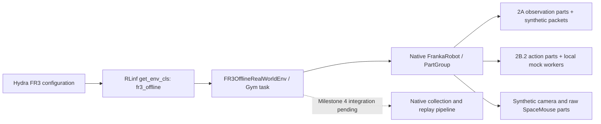

# Milestone 3 — FR3 RLinf Configuration and Environment Registration

This milestone connects the audited FR3/Robotiq interfaces to RLinf's native configuration, environment factory, robot composition and observation batching for **offline synthetic validation**. It provides a selectable environment and a configuration checker; physical collection remains blocked. The sections below explain the usable offline path, its mappings and lifecycle, then the remaining recorder and hardware requirements.

**Qualification gate: `NO_GO`. Physical safety: `NOT_QUALIFIED`. Physical command authorization: `NOT_GRANTED`.** Construction, synthetic approval and passing tests cannot change these decisions.

## Baseline and Evidence

Work started on `branch-openpi-recap-franka-fresh` at `9cee74c18aebb4bc04c7a653b71774b638b997c5`, with a clean working tree and an identical fetched remote tip. Only this branch, native RLinf code and its completed milestone evidence were inspected. The upstream open PR/issue search for `FR3 configuration` returned no matches. An AI assistant prepared the implementation for the human submitter.

The reviewed reports are [Milestone 1](milestone_1_hardware_interface_audit.md), [2A](milestone_2a_ros2_observation_adapter.md), [2B.1](milestone_2b1_action_safety_contract.md), [2B.2](milestone_2b2_ros2_action_adapter.md), [2C](milestone_2c_passive_readiness.md), [2D](milestone_2d_passive_readiness_gaps.md), and the renamed [recovery revalidation](milestone_2d_recovery_revalidation.md) with its [compact evidence](evidence/milestone_2d_recovery_revalidation.json). The revalidation filenames and contents are preserved.

The November 20 recovery capture reports successful passive observations, manager PID `516931`, active FR3 controller/hardware, all seven effort interfaces available and claimed, and advancing device time in three windows: `2535.880–2537.787`, `2537.930–2539.926`, and `2540.075–2542.070` seconds. Those findings describe that controller session. The historical libfranka `Move command aborted!` events remain valid and their root cause remains unresolved. Physical qualification and command authorization are still absent. No live recheck was performed in Milestone 3.

## Validate the Configuration

The supported entry point composes the primary Hydra configuration, resolves native values, checks synthetic dependencies and verifies both environment registrations. Run it from the repository root in the existing RLinf Python environment:

```bash
PYTHONPATH="$PWD" python -m toolkits.realworld_check.validate_fr3_config
PYTHONPATH="$PWD" python -m toolkits.realworld_check.validate_fr3_config \
  env.eval.seed=19 env.eval.max_episode_steps=2 runner.num_data_episodes=3
```

Both commands print JSON with `valid: true`, `execution_mode: offline_synthetic`, `resources_opened: false` and the unchanged qualification decisions. They construct no environment, worker, ROS endpoint or device connection. Unsupported values return JSON with `valid: false` and exit status 1; Hydra composition failures are also reported this way.

The primary file, `examples/embodiment/config/realworld_fr3_collect_data.yaml`, selects `env/fr3_offline@env.eval` using native Hydra defaults. It retains `runner.num_data_episodes`, logger settings, `env.group_name`, a one-node CPU placement description, and the native environment configuration shape. It declares no robot hardware allocation. `env/fr3_offline.yaml` defines the seven arm joints, audited device identities, observation/action names, explicit synthetic approval profile, camera fixtures and unresolved physical parameters.

Recording and video output are disabled and validation rejects enabling them. The future `data_collection` settings retain native `save_dir`, `export_format` (`pickle` or `lerobot`), `only_success`, `robot_type` and `fps` fields. The fixture `fps: 10` and image resolution are synthetic settings, without a physical operating-rate claim. Milestone 3 neither writes replay files nor exports a dataset.

## Native Architecture and Registration

The registered environment uses the native interfaces while giving the offline lifecycle its own fixed construction path:



`SupportedEnvType.FR3_OFFLINE` and `get_env_cls("fr3_offline")` select `FR3OfflineRealWorldEnv`, a subclass of `RealWorldEnv`. Its robot package registers Gym ID `FR3OfflineCollect-v0` through native `register_tasks` and `build_stack`. The package is imported only for this dedicated factory branch. It is not added to the general physical-task loader or registered as a physical robot/action backend.

This distinction matters because requesting the generic package-level `RealWorldEnv` calls `load_tasks()`, imports physical robot tasks and invokes node-level ROS 1 process cleanup. The new subclass imports the base class directly, overrides `_create_env` and supplies a no-op `realworld_setup`. It reuses `NoAutoResetSyncVectorEnv`, observation wrapping, reset batching and metric storage. The existing generic loader, physical Franka environment and collector are unchanged.

`FrankaRobot` is constructed directly from named parts; `FrankaRobot.build` and its vendor/backend defaults are bypassed. `PartGroup` and `Connection` own the synthetic parts, connection rollback, snapshots and disconnection. `ControllablePart` is reused by the existing offline action parts. `BaseArm` TCP commands and metre-based `BaseGripper` commands are deliberately outside this normalized-action contract.

## Observation and Device Mapping

The synthetic observation transport generates standard-message-shaped fixtures and passes them through the existing ROS 2 decoder and `FR3ROS2Observation`/`RobotiqROS2Observation` mappings. This retains their validation, field names, unavailable indicators and receipt freshness. It starts no ROS worker and joins no DDS domain. Domain 70/71 values identify the intended observation interfaces only.

| Component | Native Part / Output | Semantics |
|---|---|---|
| FR3 arm observation | `SyntheticFR3Observation`, subclass of `FR3ROS2Observation` | Seven named joint positions, velocities and efforts; pose; two wrench streams |
| Robotiq observation | `SyntheticRobotiqObservation`, subclass of `RobotiqROS2Observation` | Raw knuckle angle in radians and independent normalized closure |
| Arm action | `FR3OfflineAction` | Six normalized pose-offset channels to a fixed local mock |
| Gripper action | `RobotiqOfflineAction` | One normalized closure channel to a fixed local mock |
| Cameras | Unregistered `SyntheticCamera` parts | RGB uint8 HWC fixtures, without RealSense capture |
| SpaceMouse | Unregistered `SyntheticSpaceMouse` / `TeleopPart` | Six raw fixture axes and two buttons; no action mapping |

The native raw observation has `state` and `frames`. Sorted `state` fields concatenate into batched `states` of shape `[1,42]`:

| Field | Size | Meaning Preserved From 2A |
|---|---:|---|
| `arm_joint_effort` | 7 | FR3 joint efforts, N m |
| `arm_joint_position` | 7 | `fr3_joint1` through `fr3_joint7`, radians |
| `arm_joint_velocity` | 7 | Same joint order, rad/s |
| `base_force`, `base_torque` | 3 each | Base-frame external wrench estimate, N / N m |
| `knuckle_position_rad` | 1 | Raw knuckle angle |
| `normalized_closure` | 1 | Independent normalized closure; no calibrated width |
| `tcp_force`, `tcp_torque` | 3 each | Stiffness-frame wrench; original header remains authoritative |
| `tcp_pose` | 7 | xyz in metres, quaternion x,y,z,w; frame/TCP qualification still pending |

The fixture keeps `synthetic/base`, `synthetic/base_link` and `synthetic/fr3_link2` distinct. It neither transforms nor equates these frames. TCP velocity, Jacobian, calibrated jaw width and physical grip force remain unavailable. Synthetic observations are independent of requested actions; an unchanged fixture is not evidence of physical response or hold behavior.

Per-stream metadata is retained in `infos.ros2`: original-shaped source headers, separate local monotonic receipt timestamps, sequence, freshness/completeness, errors and unavailable fields. Every fixture sample carries `synthetic: true` and `source: offline_synthetic_fixture`. Its wall-clock header is generated data, not a robot clock measurement. `publishers: 1` and `bridge_alive` describe fixture availability, not real ROS discovery. Camera and SpaceMouse metadata separately identify synthetic origin, local monotonic clock domain and unavailable device-source timestamps. Infos, rather than the dense state tensor, retain this provenance; Milestone 4 must record both.

The camera identities remain D405 serial `323743071035` and D435i serial `327743060094`. Physical base/wrist roles, stream profiles, intrinsics, mounting transforms and calibration remain null. `main_image_key: d435i` selects a synthetic tensor slot only. Both fixtures default to width 32, height 24, producing `main_images: [1,24,32,3]` and `extra_view_images: [1,1,24,32,3]`. Equal positive fixture dimensions are required for native view stacking.

The SpaceMouse identity is Wireless BT, USB `256f:c63a`; serial and device index remain unresolved. `teleop: none` prevents creation of a physical teleoperation wrapper. No native SpaceMouse axis transform is assumed to implement the audited FR3 controller semantics. Synthetic raw axes are visible only as input provenance, never automatically converted to a request.

## Typed Actions and Synthetic Admission

The environment accepts a batch containing one mapping with exactly `arm` and `end_effector` entries, each an existing `ActionRequest` envelope. Its seven-channel Gym Box documents numerical payload dimensions; **Box samples, numeric arrays, generic TCP poses, joint targets and width commands are rejected**. This explicit mismatch with a generic Gym numeric-action caller is a remaining collector integration boundary.

| Action Kind | Payload | Audited Semantics Represented by the Mock Identity |
|---|---|---|
| `fr3_normalized_pose_offset_v1` | Six finite channels in `[-1,1]` | Measured-FK-relative offsets; full translation 0.007 m, full rotation 0.03 rad; translation inverse-mount into base, rotation right-multiplied RPY in measured `fr3_link8` |
| `robotiq_normalized_closure_v1` | One finite channel in `[0,1]` | 0 open request, 1 close request; no calibrated opening width or force control |

These are neither absolute TCP poses nor SI velocities. The mock identity's zero mounting RPY is a synthetic fixture parameter, never a measured physical transform. No pose-to-Twist or teleoperation-to-controller conversion is implemented.

The 2B.2 admission checks enforce schema/type, finite dimensions and ranges without clipping, source/session/authority identity, increasing sequence, request age/expiry, shared local monotonic clock domain, observation freshness/skew, pinned mock controller/configuration, and explicit synthetic approval/limit profiles. Hardware calibration is unresolved; `synthetic:not-physical-calibration` approves only fixtures. Configured profile bounds/timing cannot authorize hardware. The task additionally binds both requests to its last synthetic observation, requires matching pair sequences and admits both before submitting either. If either fails, pending mock requests are canceled, both parts disarm and reset is required. Sequential mock submissions are not an atomic execution transaction.

`reset()` connects only in-memory fixtures and the two existing stdlib mock action workers, starts a new synthetic episode and leaves actions disarmed. The caller must explicitly call `authorize_synthetic()` before admission. `create_normalized_action(...)` constructs envelopes from explicit normalized values and the last observation; it neither approves nor submits them. `step([requests])` validates and submits to the fixed mocks, then returns native tensors and synthetic infos. Renewing mock authorization discards previous pending mock work. Gripper terminal outcomes disarm its part under the existing 2B.2 lifecycle. A new action pair therefore needs explicit mock authorization when either part has disarmed.

The native bounded action journal retains created/requested, validated, admitted, simulated submitted and mock disposition events with schema version, source/request identity, timestamps, approval and observation provenance. Arm submission may remain `acceptance_unknown`; a mock gripper acknowledgement/result asserts no physical acceptance, grasp or execution. Pair-boundary shape/provenance failures raise explicit exceptions before submission; they do not create a successful trajectory. Infos always label controller acceptance and measured physical response unavailable.

`close()` explicitly closes owned task resources because the generic base class inherits Gym's no-op close. Repeated close is safe; close/reset reconnect creates new session and authority epochs without replay. Horizon truncation disarms mock actions and requires reset. Reward 0, termination false and horizon truncation are fixture plumbing only: `reward_evaluated: false`, `success_evaluated: false`, and `eligible_real_demonstration: false` remain explicit. No real task reward, success, release, recovery or reset motion is defined.

## Native Collection Compatibility

The configuration follows the native layout, but `collect_real_data.py` cannot consume it as a functioning collection pipeline. That script hardcodes generic `RealWorldEnv`, reaches the physical task/setup loader, creates numeric zero arrays, optionally replaces them with `intervene_action`, and records dense actions. It does not select the new factory branch or preserve typed request/approval/disposition provenance. **Do not run `collect_data.sh` with this configuration.**

`TrajectoryStep` can retain native tensor observations in memory, as tested without writing/exporting trajectories. Its single dense `actions` tensor represents executed training actions and cannot represent all requested, validated, admitted, mock-submitted, acknowledged and measured stages on its own. `TrajectoryReplayBuffer` accepts native trajectories, with optional automatic persistence in the current collector. A future recorder must preserve supplemental structured provenance and explicitly synthetic/unscored episode identity before this environment enters that path.

The native optional `CollectEpisode` writer supports pickle and LeRobot settings, but it is not enabled or inserted into this task. Manual episode termination/scoring, unscored rejection policy, reward/success semantics and action-recording interpretation require explicit recorder design. Neither a passing schema test nor optional `export_format: lerobot` implements export or creates real demonstrations.

## Validation and Changed Files

All validation used Python 3.11 on CPU, synthetic fixtures and owned local mock processes. The baseline suites passed with 495 robotics tests (8 placement tests excluded) and 216 real-environment tests (18 placement tests excluded). The final checks passed:

| Check | Result |
|---|---|
| Full CPU robotics suite, including 2A/2B.2/2D regressions | 495 passed; 8 placement tests deselected |
| Full CPU real-environment suite | 280 passed; 18 placement tests deselected; the same one warning as baseline |
| New FR3 configuration/environment cases within that suite | 64 passed |
| Hydra default/override validation and invalid-input reporting | Passed; fixed offline factory and structured JSON |
| Fresh-process hardware guards | Passed with ambient ROS domains 70 and 71; SDK imports, process discovery and Ray initialization forbidden; only mock workers permitted |
| Ruff lint and formatting, package `__init__.py` check | Passed |
| EN/ZH Sphinx builds | Zero warnings under the default autodoc filtering |
| Changed-guide markup and code-symbol checks | Passed |
| Milestone Markdown links, recovery-evidence consistency and whitespace diff | Passed |

The 64 cases cover camera identifiers/dimensions, unresolved mapping/calibration, domains, unsupported execution/backend choices, explicit synthetic approval, typed payload validation, observation provenance/freshness, session/clock/sequence/expiry rejection, paired admission without partial validation submission, native tensor shapes, numeric-collector rejection, reconnect/disarming, truncation and worker cleanup. Placement tests were deliberately excluded; no hardware or GPU execution is claimed.

The scoped files are:

| Files | Responsibility |
|---|---|
| `examples/embodiment/config/realworld_fr3_collect_data.yaml`, `examples/embodiment/config/env/fr3_offline.yaml` | Native Hydra primary and fixed offline environment configuration |
| `rlinf/envs/__init__.py` | Lazy native factory branch and enum |
| `rlinf/envs/real/fr3/__init__.py`, `config.py`, `offline.py` | Gym registration, schema/admission dependencies, native offline environment/task |
| `rlinf/robotics/parts/fr3_synthetic.py`, `rlinf/robotics/parts/transports/ros2/synthetic.py` | Synthetic parts and packets using the existing observation decoder |
| `toolkits/realworld_check/validate_fr3_config.py` | Resource-free validation command |
| `tests/unit_tests/test_real_env.py` | Focused offline contract and lifecycle cases |
| `docs/source-{en,zh}/rst_source/guides/fr3_ros2_observation.rst` | Matching user instructions in both languages |
| `docs/fr3_fresh/milestone_3_rlinf_configuration.md` | Scope, evidence, compatibility boundaries and next steps |

Existing 2A observation, 2B.2 action, 2D readiness and physical environment/collector source remain unchanged.

Reproduce the hardware-free regression and static checks from the repository root:

```bash
PYTHONPATH="$PWD:$PWD/tests/unit_tests" pytest -q tests/unit_tests/test_robotics.py -m 'not placement'
PYTHONPATH="$PWD:$PWD/tests/unit_tests" pytest -q tests/unit_tests/test_real_env.py -m 'not placement'
ruff check --preview rlinf/envs/__init__.py rlinf/envs/real/fr3 \
  rlinf/robotics/parts/fr3_synthetic.py rlinf/robotics/parts/transports/ros2/synthetic.py \
  toolkits/realworld_check/validate_fr3_config.py tests/unit_tests/test_real_env.py
ruff format --check rlinf/envs/__init__.py rlinf/envs/real/fr3 \
  rlinf/robotics/parts/fr3_synthetic.py rlinf/robotics/parts/transports/ros2/synthetic.py \
  toolkits/realworld_check/validate_fr3_config.py tests/unit_tests/test_real_env.py
python tests/unit_tests/check_missing_init.py
python .agents/skills/docs-check/build_docs.py --venv /tmp/fr3-m2a-docs-venv
git diff --check
```

The documentation build environment above is the existing local docs environment; supply your docs virtualenv path elsewhere. Both EN/ZH builds use the harness's default autodoc filtering. The standalone milestone Markdown is checked separately for relative links and consistency. This checkout has no `.github/workflows/ci-tests.yml` path filter to extend.

## Remaining Blockers and Milestone 4

Milestone 4 should integrate a hardware-inaccessible synthetic recorder through the native factory, with typed request submission, episode boundaries, provenance retention and replay-schema validation. It must retain distinct raw operator input, requested action, validation/admission, mock submission/result and synthetic observation stages. Specify unscored reward/success handling before retaining episodes; identify every synthetic sample and keep any future export separate from real demonstrations. This work has not started here.

Physical acquisition and action integration require separate authorization and qualification: frame/base/TCP/tool transforms; calibrated gripper width/direction/contact/effort behavior; camera roles/profiles/transforms and SpaceMouse mapping; exclusive command handover including existing bridge/pending goals; bounded observation/action freshness and clock uncertainty; independent protective/emergency safeguards; handling of historical libfranka aborts and long-term stability; approved physical limits and named operator signoff. Follow the [physical qualification plan](fr3_physical_qualification_plan.md).

Milestone 3 introduces no live action transport, ROS command publisher, gripper action client, hardware discovery, camera/HID acquisition or physical collection. It stops at offline configuration/environment integration with `NO_GO / NOT_GRANTED`.
