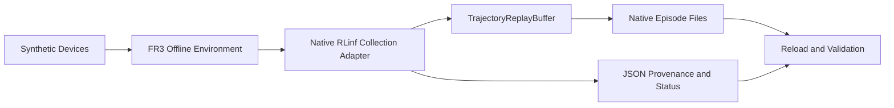

# Milestone 4 — FR3 Native Data Collection Integration (Offline)

This milestone records, saves, reloads and validates complete **synthetic demonstration episodes** through RLinf's native trajectory and replay-buffer APIs. A dedicated offline entry point reconciles typed FR3 actions with native tensor storage, while JSON sidecars retain their provenance. This report explains the runnable workflow, data and timing contracts, failure handling, validation results and remaining physical qualification requirements.

**Physical safety remains `NOT_QUALIFIED`, command authorization `NOT_GRANTED`, and qualification gate `NO_GO`.** Dataset `COMPLETE` means verified synthetic storage and cleanup. It grants no permission to operate hardware or collect real demonstrations.

## Baseline and Inspected Evidence

Work started from a clean `branch-openpi-recap-franka-fresh` at `52d0ef45757bf6132fe019493e85fa35a63d0ec2`. Fetching that branch confirmed an identical remote tip. The upstream PR/issue search for `FR3 recorder` found no overlapping work. An AI assistant prepared this scoped change for the human submitter.

The reviewed interfaces follow [Milestone 1](milestone_1_hardware_interface_audit.md), [2A](milestone_2a_ros2_observation_adapter.md), [2B.1](milestone_2b1_action_safety_contract.md), [2B.2](milestone_2b2_ros2_action_adapter.md), [2C](milestone_2c_passive_readiness.md), [2D](milestone_2d_passive_readiness_gaps.md), and [Milestone 3](milestone_3_rlinf_configuration.md). The renamed [recovery revalidation](milestone_2d_recovery_revalidation.md) and [compact evidence](evidence/milestone_2d_recovery_revalidation.json) are preserved unchanged.

The November 20 recovery capture reported advancing FR3 device time, active controller/hardware, all seven effort interfaces available/claimed and successful passive observations in manager session PID 516931. These session-specific findings remain distinct from the unresolved historical libfranka `Move command aborted!` events. Milestone 4 performs no live readiness recheck, communication test, device acquisition or physical action.

## Record and Validate a Synthetic Dataset

Use the dedicated entry point from the repository root in the existing RLinf Python environment:

```bash
PYTHONPATH="$PWD" python -m examples.embodiment.collect_fr3_offline \
  --output /tmp/fr3-milestone4-synthetic \
  runner.num_data_episodes=2 env.eval.max_episode_steps=4 env.eval.seed=7
PYTHONPATH="$PWD" python -m examples.embodiment.collect_fr3_offline \
  --output /tmp/fr3-milestone4-synthetic --validate-only
```

The first command composes `realworld_fr3_collect_data.yaml`, constructs the fixed `fr3_offline` factory, records two four-step episodes, saves a native checkpoint and verifies its reload. The second independently validates stored artifacts and reloads them through `TrajectoryReplayBuffer`. Native buffer log messages precede the final compact JSON report, which reports `episodes: 2`, `steps: 8`, `native_reload: true` and `physical_execution: false`.

The output directory must be new. Repeating the collection command with the same path fails without overwriting it; use a new directory for another run. Seeded numeric payloads, images and logical times are reproducible. Session/authority UUIDs, host receipt times, wall times and serialized file hashes can differ between runs.

The primary Hydra file now contains `offline_collection` schema/version and synthetic period/age/skew settings. Native `runner.num_data_episodes`, `env.eval.max_episode_steps`, `env.eval.seed`, camera fixture dimensions and existing synthetic approval profiles remain the inputs. The legacy `data_collection.enabled` and video flags stay false. This entry point writes native replay data directly through its fixed synthetic path; those legacy flags cannot enable a physical writer. Invalid modes, controller/backend choices or physical hardware allocations fail validation before creating an output or connecting resources.

## Native Collection Architecture

The existing collection script establishes the supported storage contract, but its action and episode-selection assumptions require an offline adaptation:

| Native Component | Verified Contract and Reuse |
|---|---|
| `collect_real_data.py` | Creates numeric zero actions; intervention wrappers can replace them through `intervene_action`; retained demonstrations are selected using reward/manual completion and marked with expert intervention flags. It hardcodes generic `RealWorldEnv`. |
| `collect_data.sh` | Starts that script and its Ray-backed collection setup. It is not the offline entry point and was not run. |
| `RealWorldEnv` | Native vector batching, state/image tensor wrapping and metrics are reused by the Milestone 3 subclass. Generic package loading invokes physical-task/node setup; the dedicated factory bypasses it. |
| `TrajectoryStep` / `TrajectoryAccumulator` | Retain current/next tensor observations, dense action, reward and boundary fields; stack time-major trajectories using the actual native API. |
| `TrajectoryReplayBuffer` | Native asynchronous trajectory serialization, checkpoint index/metadata and `load_checkpoint` are reused. `save_checkpoint` waits for trajectory writes and propagates their failures before finalization. |
| `CollectEpisode` | Supports numeric episode recording and optional pickle/LeRobot export. It does not encode these typed request stages; this milestone uses the native accumulator instead of adding a duplicate export writer. |

The new adapter is a local loop over these native APIs. It neither starts Ray workers nor imports the physical collection script. Production Franka backends, the generic collector, replay schemas and existing observation/action/readiness implementations remain intact.



`collect_synthetic_dataset(cfg, output)` validates dependencies, exclusively creates the dataset directory, obtains `FR3OfflineRealWorldEnv` through `get_env_cls`, and owns all subsequent resources. Each reset starts a new disarmed mock session. The recorder explicitly grants existing synthetic-only approval, creates typed requests, calls the native batched `step`, then appends `TrajectoryStep` to `TrajectoryAccumulator`. A completed horizon becomes one trajectory passed to `add_trajectories`.

## Observations, Inputs and Actions

Synthetic device fixtures feed the existing observation decoder and native part composition. `SyntheticFrame` supplies deterministic joint/pose samples, independent raw knuckle angle and normalized closure, RGB camera pixels and raw SpaceMouse axes. These scripted state values are independent of submitted actions; they provide data-flow coverage without claiming robot dynamics or physical response.

| Representation | Stored Shape / Semantics |
|---|---|
| `curr_obs.states`, `next_obs.states` | `[T,1,42]`, the sorted Milestone 3 state fields: seven joint positions/velocities/efforts, pose xyz+xyzw, two force/torque streams and two gripper scalars |
| `main_images` | `[T,1,24,32,3]` for default D435i RGB uint8 HWC fixtures |
| `extra_view_images` | `[T,1,1,24,32,3]` for default D405 fixtures |
| `actions`, `forward_inputs.action` | `[T,1,7]`, the payload actually submitted to both local mocks: six normalized offsets followed by normalized closure |
| `rewards` | `[T,1,1]`, zero with origin `unscored_fixture_zero`; reward/task success is not evaluated |
| `dones`, `terminations`, `truncations` | `[T,1,1]`; only the final synthetic-horizon truncation/done is true; termination stays false |
| `intervene_flags` | `[T,1,7]`, false; no human/expert or policy intervention is asserted |

The action kinds remain `fr3_normalized_pose_offset_v1` and `robotiq_normalized_closure_v1`. Arm values are six finite normalized offsets in `[-1,1]`, with audited mock identity scales 0.007 m and 0.03 rad and distinct translation/rotation composition. They are not absolute TCP poses or SI velocities. Closure is one normalized value in `[0,1]`, not calibrated width or force. No pose-to-Twist conversion exists.

Raw scripted SpaceMouse input, an explicitly scripted normalized request and its interpretation identifier are recorded separately. `physical_mapping_verified` is false and the physical SpaceMouse mapping remains null. This fixture script establishes no verified device-to-controller mapping. D405 serial `323743071035` and D435i serial `327743060094` remain identities only; physical camera roles and calibration remain unresolved. Fixture `main_images` selection is not a mounting-role claim.

The environment exposes a retained synthetic snapshot without polling devices, and accepts a staged synthetic frame for the next observation. Incomplete state or missing/malformed images are rejected. Default Milestone 3 fixtures keep their existing behavior when no staged frame is supplied. No unavailable TCP velocity, Jacobian, calibrated jaw width or measured grip force is manufactured.

## Action Provenance and Timing

A JSONL request/outcome pair accompanies every retained step. It binds the dense tensor to its intended action and associated observation, rather than treating that tensor as physical execution evidence:

| Stage | Recorded Evidence |
|---|---|
| Operator request | Raw synthetic axes/buttons and input timing, source ID, explicit scripted interpretation, requested six-channel arm values and closure |
| Typed request | Kind/schema, values, source/session/authority, sequence, generation/expiry, local clock identity, interface identity and immutable observation provenance |
| Validation/admission | Existing bounded 2B.2 journal events, approval/profile, disposition and explicit rejection/failure reasons |
| Mock submission | Submitted event and timestamp, expected mock message representation, acknowledgement/result or failure/timeout/cancellation |
| Observation | Full arm/gripper state and stream metadata; camera metadata, tensor slots and pixel hashes; raw SpaceMouse input; source/receipt timing and frame identities |

Arm mock acceptance normally remains unknown, followed by an explicit end-of-interval **mock cancellation**. This does not establish controller hold, a protective stop or an emergency stop. Robotiq mock acknowledgement/completion is required for a valid stored step and establishes no physical grasp. Physical controller acceptance is `UNAVAILABLE`; physical grasp success is null. Every request/outcome, episode and dataset denies physical execution.

Three timestamp contexts remain separate:

1. **Synthetic logical clock:** one per-dataset `ManualClock`, shared by all five fixture streams. The default period is 100,000,000 ns. Sources precede observation boundaries by 3 ms (arm), 2 ms (gripper), 8 ms (D405), 5 ms (D435i) and 1 ms (SpaceMouse); modeled arrival offsets differ and remain at/before the boundary. These are test fixtures, not measured hardware/network timing.
2. **Synthetic ROS-shaped source headers:** `sec`/`nanosec` use the documented fixture epoch offset `1700000000000000000` ns plus logical source time. Each sample preserves that offset and source clock identity. Camera/SpaceMouse physical device timestamps remain unavailable; their modeled source/arrival times are under `fixture_timing`.
3. **Actual local monotonic clock:** native receipt times, request generation/expiry, mock events and recorder timestamps retain the same process clock identity. Dataset wall-clock start/end timestamps are retained separately. Neither logical time nor ROS headers are directly subtracted from native admission times, and no inter-host monotonic comparison occurs.

Alignment is `latest_before_action_no_substitution`. Logical boundary *i* supplies the observation and input for request *i+1*; boundary *i+1* supplies its next observation. Each stream must have the same frame index, logical boundary and synthetic clock, with source <= arrival <= boundary. Default modeled age/skew limits are 50 ms and 20 ms. Missing, future-arriving, stale or skewed samples invalidate the episode; older frames are never silently substituted. Native admission separately checks real local receipt freshness, expiry and approved synthetic profile bounds. These fixture bounds qualify no physical timing guarantee.

## Dataset Layout and Finalization

The native buffer writes provisional files in an owned `.buffer` directory. After capture, `save_checkpoint` produces the native `demos` directory, resources are closed, provisional storage is removed and all remaining artifacts are flushed and hashed. The final layout is deterministic by episode/trajectory index:

```text
<new-output>/
  manifest.json
  demos/
    metadata.json
    trajectory_index.json
    trajectory_0_<native-model-weights-id>.pt
    trajectory_1_<native-model-weights-id>.pt
  episodes/
    episode_000000/
      episode.json
      steps.jsonl
    episode_000001/
      episode.json
      steps.jsonl
```

The manifest retains dataset/session ID, environment and schema identities, configuration SHA-256, recorder component version/source hash, robot/gripper/interface identities, camera identities/unresolved roles, seed, clock domains, dataset timestamps, expected counts, relative sidecar paths and file digests. Episode metadata retains the native environment episode/session/authority identities, start/end times, step count, reward/intervention meanings and termination reason. Serialized metadata uses relative artifact paths and includes no machine-specific output path.

Dataset status advances `WRITING` → `VERIFYING` → `COMPLETE`. Episode status advances `WRITING` → `CAPTURED` → `COMPLETE` during finalization. A usable dataset requires both finalized episode records and the finalized manifest. The validator checks hashes and artifact inventory, native index/counts, tensor shapes/boundaries, state/pixel associations, observation continuity, source and recorder clocks, operator/request consistency, session epochs, native action admission at recorded times, wire representation and mock dispositions. It reloads every trajectory through native `load_checkpoint` before publishing `COMPLETE`.

On failure, the dataset and retained episode markers become `INCOMPLETE` where writing remains possible. A disk error or abrupt process termination can leave `WRITING`/`VERIFYING` or missing artifacts; the loader rejects those states. The last attempted request, available rejection/failure events and planned missing/delayed sample timing remain in JSONL when persistable. Cleanup attempts all owned environment/buffer resources and records cleanup errors. It never activates, recovers or repositions hardware. There is no automatic resume, overwrite or command replay.

The replay writer keeps its native file schema unchanged. Sidecars supply semantics that legacy dense-action consumers do not retain. This milestone implements no LeRobot export or training-data quality claim. Software bounds cap collection at 100 episodes, 1,000 steps per episode and 128 MiB of current/next image payloads; these bound fixtures and validation memory, not robot safety limits.

## Validation Results and Changed Files

The example at `/tmp/fr3-milestone4-synthetic` contains **two complete episodes, four steps each, eight total steps**. Collection and the separate `--validate-only` command both succeeded. Its nine files comprise two native `.pt` trajectories, two native replay metadata/index files, four episode sidecars and one finalized manifest. No synthetic dataset binary is committed.

| CPU Check | Result |
|---|---|
| Robotics suite, including 2A/2B.2/2D regressions | 495 passed; 8 placement tests deselected |
| Native environment suite, including Milestone 3 | 280 passed; 18 placement tests deselected; same one warning as baseline |
| Applicable data/collector suite | 163 passed, including 43 new FR3 cases; one unrelated baseline VLM test deselected; 16 warnings |
| Full data baseline before implementation | 120 passed, one unrelated failure: `test_vlm_trend_batch_video_metadata_stays_nested_per_sample`; installed `VideoMetadata.__init__` rejects `frames_indices` |
| Hydra, dedicated collection/reload CLI, hardware guards | Passed; wrong live overrides create no output; SDK imports, physical/process discovery and Ray initialization blocked in guarded runs |
| Ruff, formatting, package/import, Markdown links, diff checks | Passed for scoped changes |
| EN/ZH Sphinx and guide markup/symbol checks | Both builds: zero warnings under default autodoc filtering; markup and symbol checks passed |

No doc-code or EN-ZH consistency issues found in checked scope. The guide also now describes the existing read-only `inspect_status` IPC/service-query path accurately.

The new cases cover reset-time missing-sample rollback, multi-episode save/reload, deterministic payloads, native schemas, normalized action provenance, timestamp/frame association, asynchronous arrivals, missing/stale/skewed samples, rejected/expired/unapproved actions, mock faults/rejection/ack timeout/crash/IPC failure, interrupted recording, disk/serialization/status-write/cleanup failures, overwrite refusal and metadata/tensor corruption. The unrelated VLM implementation and installed dependencies are unchanged.

Reproduce the relevant tests and documentation checks:

```bash
PYTHONPATH="$PWD:$PWD/tests/unit_tests" pytest -q tests/unit_tests/test_robotics.py -m 'not placement'
PYTHONPATH="$PWD:$PWD/tests/unit_tests" pytest -q tests/unit_tests/test_real_env.py -m 'not placement'
PYTHONPATH="$PWD:$PWD/tests/unit_tests" pytest -q tests/unit_tests/test_data.py \
  -k 'not test_vlm_trend_batch_video_metadata_stays_nested_per_sample' -m 'not placement'
PYTHONPATH="$PWD" python -m toolkits.realworld_check.validate_fr3_config
python tests/unit_tests/check_missing_init.py
python .agents/skills/docs-check/build_docs.py --venv /tmp/fr3-m2a-docs-venv
git diff --check
```

The excluded VLM case is documented above, rather than treated as passing. The documentation command uses the existing local docs environment and the harness's default autodoc filtering. Standalone milestone Markdown receives separate link/consistency checks. This checkout has no CI workflow path filter to extend.

| Files | Change |
|---|---|
| `examples/embodiment/collect_fr3_offline.py` | Dedicated fixed offline entry point and reload validation command |
| `examples/embodiment/config/realworld_fr3_collect_data.yaml` | Synthetic recorder schema/timing settings |
| `rlinf/data/collectors/__init__.py`, `rlinf/data/collectors/fr3_offline.py` | Local native collection adapter and fixed failure fixtures |
| `rlinf/data/storage/fr3_synthetic.py` | Provenance/status sidecars and semantic/native reload validation |
| `rlinf/envs/real/fr3/offline.py` | Staged fixture frames, retained snapshot API, complete-state/image checks |
| `rlinf/robotics/parts/fr3_fixtures.py` | Deterministic multimodal samples and logical alignment contract |
| `rlinf/robotics/parts/fr3_synthetic.py`, `rlinf/robotics/parts/transports/ros2/synthetic.py` | Fixture data and explicit timing provenance through existing parts/decoder |
| `tests/unit_tests/test_data.py` | Native recorder, corruption, lifecycle and failure regressions |
| EN/ZH `guides/fr3_ros2_observation.rst` and this report | Runnable offline recording instructions and qualification boundary |

## Remaining Physical Blockers and Milestone 5

Real demonstrations still require qualified frame/base/TCP/tool transforms, calibrated Robotiq direction/width/contact/effort behavior, camera roles/profiles/extrinsics and a verified SpaceMouse mapping. Command-authority handover, bridge/pending-goal ownership, real observation/device freshness, network and clock bounds, failure/stop behavior, independent protective/emergency safeguards and named operator approval remain unresolved. Historical libfranka abort diagnosis and sustained acquisition stability are also outstanding; the passive recovery snapshot does not establish permanent repair. Follow the [physical qualification plan](fr3_physical_qualification_plan.md).

Recommended Milestone 5 is an offline dataset review and recorder qualification: review representative episodes and failure evidence, specify downstream typed-action consumption, and qualify any proposed export/schema migration with synthetic fixtures. Any subsequent physical acquisition or command integration requires a separate scoped authorization and operator-reviewed plan. Milestone 4 ends here with `NO_GO / NOT_GRANTED` and no live action transport, real-device acquisition or physical collection.
