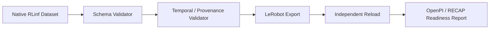

# Milestone 5 — FR3 Dataset Validation and LeRobot Compatibility

This report qualifies the Milestone 4 synthetic dataset for offline native serialization, multimodal schema checks, timing association and typed action provenance. Use the commands below to produce a quality report, export the supported fields through RLinf's native LeRobot writer, and audit the export in a separate process. OpenPI π₀.₅ and RECAP experimental readiness remain unresolved.

**Physical execution: `NO_GO / NOT_GRANTED`. Physical safety and real-world demonstration qualification: `NOT_QUALIFIED`. Every retained transition has `physical_execution = false`.** Synthetic state is independent of submitted mock actions; passing these checks establishes neither robot dynamics nor policy readiness.

## Scope and Inspected Sources

Work started from clean `branch-openpi-recap-franka-fresh` at `4777292b9a58cec9c28ea8b6005a7654ea9d40f5`. Fetching only that remote branch confirmed the same baseline. The upstream open PR/issue search for `FR3 dataset` returned no matches. An AI assistant prepared the implementation and report for the human submitter. Only the fresh branch and installed dependency source were inspected; no older experimental branch was used.

The review covered [Milestone 1](milestone_1_hardware_interface_audit.md), [2A](milestone_2a_ros2_observation_adapter.md), [2B.1](milestone_2b1_action_safety_contract.md), [2B.2](milestone_2b2_ros2_action_adapter.md), [2C](milestone_2c_passive_readiness.md), [2D gaps](milestone_2d_passive_readiness_gaps.md), [recovery revalidation](milestone_2d_recovery_revalidation.md) and its [evidence](evidence/milestone_2d_recovery_revalidation.json), [Milestone 3](milestone_3_rlinf_configuration.md), and [Milestone 4](milestone_4_data_collection_integration.md).

The recovery evidence remains a passive, session-specific observation. Its advancing FR3 device time and controller visibility do not resolve the historical libfranka abort root cause, Robotiq serial acquisition freshness, physical timing qualification, calibration or exclusive command authority. This milestone performed no live recheck, ROS discovery, camera acquisition, teleoperation, controller change, NUC change or physical action. No training or physical policy inference ran.

The source review traced `TrajectoryStep` and `TrajectoryAccumulator.to_trajectory`, native accumulation/finalization, `TrajectoryReplayBuffer` serialization, indexing and reload, `CollectEpisode`, `LeRobotDatasetWriter`, installed LeRobot 0.3.3, existing environment/data tests, and the Milestone 4 recorder/validator. `CollectEpisode` derives episode success and can skip frames missing required fields; it does not preserve this FR3 journal contract. The export therefore uses the existing native writer directly after validation, with an explicit feature schema and no success inference.

## Validation Architecture and Changed Files

The assessor reuses Milestone 4's semantic checks and native replay loader, then adds diagnostics and modality/timing checks around the same artifacts. It never opens an environment or repairs, reorders, interpolates, clips, repeats or discards samples.



| File | Responsibility |
|---|---|
| `rlinf/data/storage/fr3_validation.py` | Read-only assessment, modality contracts, synchronization distributions, episode/transition diagnostics and downstream gates |
| `rlinf/data/storage/lerobot/fr3_export.py` | Native-writer conversion, exact native archive, export inventory and independent field audit |
| `rlinf/data/storage/lerobot/writer.py` | Optional `root` argument forwarded to the installed native LeRobot API; existing callers keep default behavior |
| `toolkits/realworld_check/validate_fr3_dataset.py` | Separate-output CLI, export/reload selection, quality JSON and failure exit status |
| `tests/unit_tests/test_data.py` | Dataset corruption, schema, timing, provenance, export/reload and non-destructive validation cases |
| EN/ZH `guides/fr3_ros2_observation.rst` | Matching offline assessment/export instructions |
| This report and `evidence/milestone_5_dataset_quality.json` | Scope, reproducible evidence, compatibility limits and next work |

`assess_synthetic_dataset(root)` returns a JSON-compatible report even for malformed manifests and corrupted artifacts. Diagnostics carry category, episode/step path, exception type and message. `export_synthetic_dataset(root, destination)` requires a valid dataset and a new, separate destination. Its `export.json` advances through `WRITING`, `VERIFYING`, `COMPLETE`; failure retains partial artifacts with `FAILED` and the error. `audit_synthetic_export(destination)` verifies the bundle inventory and archived native manifest, opens a fresh `LeRobotDataset`, and compares supported fields. The CLI's `--reload-export` also verifies that the bundle belongs to the requested source manifest.

## Native Dataset and Observation Contract

The original `/tmp/fr3-milestone4-synthetic/manifest.json` was present and was not regenerated or overwritten. It declares `fr3_synthetic_dataset_v1`, `fr3_synthetic_provenance_v1`, observation/action schema version 1, two episodes, four transitions each, seed 7 and a 100 ms logical step period. Its SHA-256 is `7101f7c37cf402e1f01ce54bc31072a9500df47aa32168d8f982d7584148b220`.

The nine original files comprise the manifest, two native `.pt` trajectories, replay metadata/index, and two episode JSON/JSONL pairs. Each JSONL holds alternating request/outcome records. Relative paths, inventories, file hashes, index identities, counts, software/configuration digest syntax and gates are checked. Traversal and symlink artifacts are rejected. Hashes establish integrity relative to the manifest, not independent authenticity.

| Tensor | Exact Native Contract |
|---|---|
| `curr_obs.states`, `next_obs.states` | float32 `[T,1,42]`, finite; fields ordered as below |
| `main_images` | uint8 `[T,1,H,W,3]`, RGB HWC D435i synthetic slot |
| `extra_view_images` | uint8 `[T,1,1,H,W,3]`, RGB HWC D405 synthetic slot |
| `actions`, `forward_inputs.action` | Equal float32 `[T,1,7]`, submitted mock normalized payload |
| `rewards` | float32 `[T,1,1]`, unscored zero |
| `dones`, `terminations`, `truncations` | bool `[T,1,1]`; final done/truncation only, termination false |
| `intervene_flags` | bool `[T,1,7]`, false; no human/policy intervention asserted |

Default fixture images are 24×32 pixels. Both current and next observations must agree with sidecar values/pixel hashes and form a continuous transition chain. The native index retains its actual reward-shaped `[T,1,1]` shape descriptor, trajectory ID, sample count, horizon and model-weights UUID. That fixture UUID is not a verified policy checkpoint identity.

| State Field, in Tensor Order | Dimension | Units and Interpretation |
|---|---:|---|
| `arm_joint_effort` | 7 | N m, `fr3_joint1` through `fr3_joint7` |
| `arm_joint_position` | 7 | rad, same exact joint order |
| `arm_joint_velocity` | 7 | rad/s, same exact joint order |
| `base_force`, `base_torque` | 3 each | N / N m, preserved source frame |
| `knuckle_position_rad` | 1 | rad, `robotiq_85_left_knuckle_joint` |
| `normalized_closure` | 1 | dimensionless `[0,1]`, `robotiq_normalized_joint` |
| `tcp_force` | 3 | N, preserved stiffness-frame source |
| `tcp_pose` | 7 | xyz metres + unit quaternion xyzw; norm tolerance 1e-5 |
| `tcp_torque` | 3 | N m, preserved stiffness-frame source |

All numeric observations require exact dimensions and finite values. Source and decoded state must agree. Headers preserve distinct `synthetic/base_link` (joints/gripper), `synthetic/base` (pose/base wrench), and `synthetic/fr3_link2` (stiffness wrench). These names do not establish calibrated TCP, mounting or tool transforms. FR3 `tcp_vel`/`arm_jacobian` and gripper opening width, velocity, grip force and typed status remain explicitly unavailable. Closure is never converted to jaw width or grasp success.

D405 and D435i are checked independently for slot, image dimensions, layout, RGB encoding, uint8 pixel identity/range, source identity, timing, frame index and missing/substitution flags. Their audited serial identities are preserved. Physical roles, calibration and extrinsics remain null. Synthetic tensor-slot selection establishes no base/wrist mounting role.

SpaceMouse records six finite raw axes, two Boolean buttons, `fixture:spacemouse` identity, source/receipt timing and an explicit scripted interpretation. Device-source time and physical axis mapping remain unavailable. Raw input and normalized request are compared through their recorded interpretation and bindings; they are not assigned a physical device-to-controller transform.

## Temporal Synchronization

The validator checks three declared timestamp contexts without subtracting incompatible clocks. It reports distributions for source age, arrival age, modeled transport delay, offsets relative to arm source time, cross-stream skew, host receipt-to-recorder offsets, receipt age at request, request-to-submission and submission-to-outcome time.

| Context | Validation |
|---|---|
| Shared synthetic logical clock | Dataset-specific identity; exact step/frame boundaries; source ≤ arrival ≤ snapshot; strictly advancing source timestamps and stream sequences |
| Synthetic ROS-shaped headers | Explicit synthetic-wall domain; integer sec/nanosec; exact `1700000000000000000 + logical source ns` epoch relationship |
| Actual local monotonic clock | Same recorder/action/receipt domain; ordered recorder intervals and journal stages; receipt within episode/action interval; admission freshness and expiry checked at recorded times |

The alignment policy is `latest_before_action_no_substitution`. Initial observation plus every next observation gives **10 distinct logical boundaries**, rather than counting the reused current/next references twice. Reused source snapshots must agree exactly. Episode-local frame indices restart at zero; native stream sequences advance within each observed stream. Episode logical start/end, the one-period reset gap and recorder ordering are checked. Wall start/end ordering is checked separately.

The synthetic ceilings are **50 ms source age** and **20 ms cross-stream source skew**; a manifest cannot relax them. Missing, repeated, reversed, stale, future-arriving, substituted or wrong-domain samples fail. The quality report retains min/max/mean/p50/p95 and the full observed histogram, with sample counts.

| Original Dataset Offset | Observed Value at All 10 Boundaries |
|---|---:|
| Arm / gripper source age | 3 / 2 ms |
| D405 / D435i source age | 8 / 5 ms |
| SpaceMouse source age | 1 ms |
| Arm / gripper modeled transport delay | 1 / 1 ms |
| D405 / D435i / SpaceMouse modeled transport delay | 4 / 3 / 1 ms |
| Maximum minus minimum source time | 7 ms; p50 = p95 = 7 ms |
| D405 / D435i source minus arm source | −5 / −2 ms |

Actual host request-to-submission ranges are 9.385–11.742 ms for arm and 10.626–13.011 ms for gripper, each over eight requests. Arm joint receipt age at request spans 7.524–34.487 ms. These values describe this offline process execution; they are **not physical latency budgets or cross-host timing measurements**. Complete distributions are in the [quality evidence](evidence/milestone_5_dataset_quality.json).

## Typed Action Provenance and Episode Outcomes

Every transition retains four distinct stages. Operator request includes raw input, requested normalized values, source identity and logical input timestamp. The typed envelope retains kind/schema, dimensions, values, validation result, source/session/authority, sequence, expiry, interface and immutable observation dependency. Mock submission retains timestamp, transport wire representation, acknowledgement/result or acceptance-unknown state. The associated measured record is explicitly a synthetic observation with source/receipt times and freshness; physical controller feedback stays unavailable.

The arm kind is `fr3_normalized_pose_offset_v1`: six dimensionless channels in `[-1,1]`, measured-FK-relative controller offsets, with synthetic identity scales 0.007 m and 0.03 rad. Translation is inverse-mount into base; rotation is right-multiplied RPY in measured `fr3_link8`. This is distinct from absolute pose, SI Cartesian velocity and joint action. `robotiq_normalized_closure_v1` is one absolute normalized closure request in `[0,1]`. No additional numerical or frame conversion occurs.

The original dataset has **16 created/validated/admitted/submitted typed actions**, eight arm acceptance-unknown records and mock cancellations, and eight gripper mock acknowledgements/completions. There are **zero rejected or invalid retained transitions**. Each action binds to its source/session/authority and pre-action observation, passes native validation at its historical timestamp, and submits before expiry. Event order and unchanged request identity are checked. Arm acceptance unknown is retained, and gripper mock completion never becomes physical acceptance or successful grasp.

Episode checks cover unique dataset/episode/environment IDs, reset action sessions, step order, tensor/provenance alignment, initial snapshot, current/next continuity, final-horizon truncation, reward dtype/meaning, recorder/logical duration and finalization. Success and reward evaluation remain false. The assessor distinguishes `VALID_SYNTHETIC`, `INCOMPLETE`, `INVALID`, and `CORRUPTED_ARTIFACT` episode states, plus `REJECTED` transitions. Unindexed interrupted episodes and attempted rejected actions remain in the audit; nothing is discarded automatically.

Configuration provenance is limited: Milestone 4 saved a resolved configuration SHA-256 and software hash, but not the resolved configuration itself or a recoverable task instruction. Digest syntax and recorded associations can be checked; recovering that configuration or authenticating its origin from the hash alone is impossible. The report lists these as missing features.

## LeRobot Export and Independent Reload

The verified installed API is LeRobot **0.3.3**, dataset format **v2.1**. RLinf's existing writer now accepts an optional local `root`; all existing arguments and default behavior are preserved. Export selects integer FPS directly from the synthetic period (10 Hz here); incompatible non-integer periods fail without resampling. Other LeRobot versions are not qualified by this run.

The new bundle contains `lerobot/` for native LeRobot metadata/Parquet/image data, `native/` for byte-identical original artifacts, and `export.json` for inventory, mapping, task-label derivation, unsupported fields and audit outcome. Complex operator/request/event/source-clock provenance stays in the exact native archive and is linked by source manifest hash, episode index and frame index. That archive is required to interpret this export safely.

| Exported Fields | Independently Verified Result |
|---|---|
| `state`, `next_state` | 42 float32 values, exact equality |
| `actions` | Seven float32 submitted mock values, exact equality |
| `image`, `extra_view_image`, `next_image`, `next_extra_view_image` | D435i/D405 current and next pixels, exact equality after the loader's documented RGB CHW float conversion |
| Rewards, done, termination, truncation | Exact numerical values and boundary flags |
| `logical_ns`, `next_logical_ns` | Original int64 logical observation/action boundary timestamps |
| `request_recorder_ns`, `outcome_recorder_ns` | Original int64 local recorder timestamps |
| `physical_execution`, `synthetic` | False / true for every frame |
| `episode_index`, `frame_index`, global `index`, relative `timestamp` | Two episodes, four frames each; zero-based indexing; timestamp = frame / 10 within 1e-7 s |
| Task metadata | Fixed derived label `synthetic FR3 pipeline validation (unscored; no physical execution)` |

The audit compared **18 explicitly exported fields per transition**, plus native indexing/time metadata, over **2 episodes and 8 transitions**. The exact archive hashes matched. A second CLI process independently reopened and audited the bundle successfully. The installed HF transform squeezes one-element numeric fields to scalars; the audit explicitly restores only that singleton axis. Image decoding produces CHW float32 `[0,1]`; the audit verifies range/shape and reconstructs uint8 pixels for exact comparison. No image resizing, action normalization, temporal interpolation or episode padding occurs.

Task text is derived export metadata, not a recovered instruction. No success Boolean is invented. Calibration, physical source times, controller acceptance, outcomes, policy/checkpoint identities and intervention labels remain unavailable. A plain LeRobot frame-table consumer cannot recover the complex journal without the archive. Readiness is therefore **compatible subset with native archive**, not full downstream readiness.

## OpenPI π₀.₅ Compatibility Assessment

The existing repository transforms establish concrete incompatibilities before selecting any checkpoint. The official [OpenPI training configuration](https://github.com/Physical-Intelligence/openpi/blob/main/src/openpi/training/config.py) and [fine-tuning instructions](https://github.com/Physical-Intelligence/openpi) also use dataset-specific transforms and normalization assets. Their examples do not qualify an FR3 checkpoint. The local installed sources, rather than an assumed seven-dimensional match, determine the findings below.

| Requirement | Verified Source and Assessment |
|---|---|
| Image keys and roles | `LeRobotRealworldDataConfig` repacks `image` and `extra_view_image`; `RealworldInputs` maps them to base/left-wrist slots and masks right wrist. FR3 physical roles are unknown, so that semantic mapping is unqualified. |
| Image preprocessing | Installed `ModelTransformFactory` uses resize to 224×224 and tokenization for PI05. Export retains 24×32 fixture pixels. A future approved preprocessing chain must specify resizing and camera masks. |
| Robot state | `policies/realworld_policy.py::RealworldInputs` asserts `(19,)`; FR3 state is `(42,)`. No approved selection/reordering or calibrated pose representation exists. |
| Action representation | `RealworldInputs` accepts a horizon of seven-value actions and pads to model dimension; that shape check does not establish offset scale/frame/order/closure semantics. `FrankaEEOutputs` documents absolute xyz/RPY/gripper semantics, unlike these normalized controller offsets. |
| Model dimension/horizon | Repository `Pi0Config` defaults to dimension 32 and horizon 50; specific configurations can differ. Four-step episodes do not establish a valid target horizon or boundary-padding policy. |
| Task instructions | Native tensor observations omit `task_descriptions`; the export's derived unscored label cannot replace verified task language. |
| Normalization | `transforms/pipeline.py` orders data transforms, normalization and model transforms. Controller normalization is not model normalization. Dataset/checkpoint statistics and quantile/z-score selection remain unqualified. |
| Delta transforms | Installed `DeltaActions` subtracts state for selected absolute-action channels. Applying it to normalized controller offsets would change their meaning; no such conversion is implemented. |
| Boundaries and provenance | Native boundaries and synthetic provenance are verified. Future loaders must preserve them when forming action windows and prevent mixing synthetic fixtures with physical demonstrations. |
| Exact variant/checkpoint | No target checkpoint, assets, task-specific training configuration or FR3 data transform was selected/verified. Gate remains `UNQUALIFIED`. |

Future transformations require an explicit target action definition, calibrated base/tool/controller frames, translation and rotation composition, gripper calibration if width is required, time-window association, instruction identity and numeric normalization assets. A normalized offset could only become another action representation with those verified semantics. Neither multiplying by 0.007/0.03 alone nor padding/truncating 42 state values establishes compatibility. No speculative conversion was added.

## RECAP Metadata Requirements

The native RECAP sources already expose episode/frame-based associations: `datasets/recap/utils.py` loads task descriptions and reward/return sidecars by episode/frame; `cfg_model.py` requires matching advantage associations; `value_dataset.py` selects existing policy transforms. The following metadata must be qualified before later experiments.

| Association | Present Synthetic Evidence | Still Needed |
|---|---|---|
| Demonstration and source | Dataset/episode/environment IDs, hashes, synthetic flags, native index | Durable dataset version and physical/simulator source classification |
| Task identity | Environment identity and derived export label | Original task ID/instruction, task version and annotation origin |
| Policy rollout | No policy was run | Rollout/run/episode IDs, policy/checkpoint hash/version and configuration |
| Operator interventions | Raw scripted input, explicit false intervention flags | Real operator identity/consent as applicable, intervention start/end/type/reason and policy-to-operator association |
| Actions and authority | Typed request, validation, session, authority, sequence, expiry and mock outcomes | Verified physical submission/acceptance/feedback association where available; retain unknown/rejected states |
| Outcomes | Unscored zero reward and synthetic horizon | Evaluated success/failure, outcome reason, annotator/method/version and timestamps |
| Offline RL labels | None qualified | Reward/return definition, value-model/version, advantage labels and episode/frame alignment |
| Experimental split | No split identity | Episode-level train/eval split/version, leakage controls and source provenance |

Do not turn mock completion into success, false intervention flags into real expert labels, or the fixture model-weights UUID into a policy version. The dataset verifies a synthetic pipeline and supplies no RECAP experimental evidence.

## Reproduce the Offline Pipeline

Run these commands from the fresh repository in the installed RLinf Python environment. Every output must be new. The original dataset is only read. `HF_HUB_OFFLINE=1` prevents Hub access and the explicit `/tmp` HF cache keeps loader cache writes separate from the source.

```bash
PYTHONPATH="$PWD" HF_HUB_OFFLINE=1 HF_DATASETS_CACHE=/tmp/fr3-milestone5-hf-cache \
  python -m toolkits.realworld_check.validate_fr3_dataset \
  --dataset /tmp/fr3-milestone4-synthetic --output /tmp/fr3-milestone5-final --export
PYTHONPATH="$PWD" HF_HUB_OFFLINE=1 HF_DATASETS_CACHE=/tmp/fr3-milestone5-hf-cache \
  python -m toolkits.realworld_check.validate_fr3_dataset \
  --dataset /tmp/fr3-milestone4-synthetic --output /tmp/fr3-milestone5-evidence \
  --reload-export /tmp/fr3-milestone5-final/export
```

The first command produced a verified export bundle. The second independently loaded its files and produced the final `quality.json`, copied to [committed quality evidence](evidence/milestone_5_dataset_quality.json). Both commands returned zero. Reusing their existing output directories is rejected; select different names for another run.

If the original temporary dataset has expired, regenerate only through Milestone 4's fixed offline entry point before assessing it:

```bash
PYTHONPATH="$PWD" python -m examples.embodiment.collect_fr3_offline \
  --output /tmp/fr3-milestone4-synthetic \
  runner.num_data_episodes=2 env.eval.max_episode_steps=4 env.eval.seed=7
```

Numeric fixtures and logical offsets are reproducible. A new capture has new session IDs, actual host timestamps and file hashes. Never substitute the physical collection entry point. Synthetic fixture subprocesses may need permission for local IPC in restricted environments; they use fixed stdlib mock endpoints and no hardware SDK.

## Quality Decisions and Automated Checks

The machine-readable report separates readiness decisions. The assessed original contains **2 valid synthetic episodes, 8 valid transitions, 0 invalid/incomplete/corrupted episodes and 0 rejected/invalid transitions**. All five modality checks passed. Native serialization/reload, multimodal schema, synthetic temporal consistency and typed provenance passed. LeRobot passed for the compatible subset with required archive. OpenPI schema is `UNQUALIFIED`; real-world demonstrations are `NOT_QUALIFIED`.

Run the applicable CPU checks with the documented placement exclusion and the single previously excluded VLM case:

```bash
PYTHONPATH="$PWD:$PWD/tests/unit_tests" pytest -q tests/unit_tests/test_robotics.py -m 'not placement'
PYTHONPATH="$PWD:$PWD/tests/unit_tests" pytest -q tests/unit_tests/test_real_env.py -m 'not placement'
PYTHONPATH="$PWD:$PWD/tests/unit_tests" HF_HUB_OFFLINE=1 HF_DATASETS_CACHE=/tmp/fr3-milestone5-test-cache \
  pytest -q tests/unit_tests/test_data.py \
  -k 'not test_vlm_trend_batch_video_metadata_stays_nested_per_sample' -m 'not placement'
PYTHONPATH="$PWD:$PWD/tests/unit_tests" pytest -q tests/unit_tests/test_data.py \
  -k test_vlm_trend_batch_video_metadata_stays_nested_per_sample -m 'not placement'
ruff check --preview rlinf/data/storage/fr3_validation.py rlinf/data/storage/lerobot/fr3_export.py \
  rlinf/data/storage/lerobot/writer.py toolkits/realworld_check/validate_fr3_dataset.py tests/unit_tests/test_data.py
ruff format --check rlinf/data/storage/fr3_validation.py rlinf/data/storage/lerobot/fr3_export.py \
  rlinf/data/storage/lerobot/writer.py toolkits/realworld_check/validate_fr3_dataset.py tests/unit_tests/test_data.py
PYTHONPATH="$PWD" python -m toolkits.realworld_check.validate_fr3_config
python tests/unit_tests/check_missing_init.py
UV_CACHE_DIR=/tmp/fr3-milestone5-uv-cache python .agents/skills/docs-check/build_docs.py --venv /tmp/fr3-m2a-docs-venv
/tmp/fr3-m2a-docs-venv/bin/python .agents/skills/docs-check/check_rst_markup.py \
  docs/source-en/rst_source/guides/fr3_ros2_observation.rst docs/source-zh/rst_source/guides/fr3_ros2_observation.rst
/tmp/fr3-m2a-docs-venv/bin/python .agents/skills/docs-check/check_doc_symbols.py \
  docs/source-en/rst_source/guides/fr3_ros2_observation.rst docs/source-zh/rst_source/guides/fr3_ros2_observation.rst
git diff --check
```

The VLM command deliberately reproduces the known unrelated failure; it is not a passing check. See actual results below. This checkout has no `.github/workflows/ci-tests.yml` path filter to extend.

| Check | Actual Result |
|---|---|
| Robotics CPU regression | 495 passed; 8 placement tests deselected, matching Milestone 4 |
| Real-environment CPU regression | 280 passed; 18 placement tests deselected; one existing deprecation warning, matching Milestone 4 |
| Applicable data regression | 222 passed, including 59 new cases; the same one unrelated VLM case deselected; 76 dependency warnings |
| Existing VLM exclusion, independently rerun | Failed unchanged: installed transformers 4.57.6 `VideoMetadata.__init__` rejects `frames_indices`; signature requires `video_backend`. No FR3 call path or change participates. |
| Native quality/export/independent reload | 2 episodes / 8 transitions passed, exact supported-field audit and archive hashes |
| Hardware-inaccessibility guard | SDK imports forbidden in separate CLI export/reload processes; no physical operation |
| Ruff / format / package / configuration / docs | Scoped lint/format, package/import, configuration and changed-guide checks passed; EN/ZH Sphinx: zero warnings under default autodoc filtering |

New failure cases cover missing episode files, corrupted `.pt`, invalid/duplicate-key/nonfinite manifests, wrong tensor dimensions/dtypes, nonfinite observations, non-unit quaternion, joint/frame ordering, wrong action kind/range/expiry/source, missing/malformed provenance, false physical claims, duplicate transitions/timestamps, missing/stale/skewed camera frames, incompatible clocks, recorder receipt ordering, incomplete/unindexed episodes, schema mismatch, index/forward-action mismatch, invalid task labels, real LeRobot round-trip corruption and creation/reload failures. Tests rehash modified fixtures so semantic checks run beyond integrity checking. Non-destructive source hashes and diagnostic paths are asserted. Hardware-dependent placement tests remain excluded; no new exclusion was introduced.

Repository-wide markup/name scans also reported existing findings outside the changed guide (including 26 illustrative/undefined names); those files are unchanged. Scoped EN/ZH guide scans passed with no markup or symbol findings. The standalone milestone Markdown and relative links were checked separately.

The installed environment is Python 3.11.15, torch 2.11.0+cu130 used on CPU, NumPy 1.26.4, LeRobot 0.3.3, datasets 3.6.0 and PyArrow 18.1.0. LeRobot image/numeric conversions emit dependency deprecation warnings. Initial sandbox attempts blocked local mock IPC and Sphinx sitemap multiprocessing; those commands were rerun with permission outside the sandbox, without enabling hardware or changing code to evade restrictions.

## Remaining Blockers and Recommended Milestone 6

The next useful software milestone is to select and pin the exact OpenPI π₀.₅ checkpoint/configuration, define a versioned FR3 state/action preprocessing contract with source-level tests, and store resolved configuration, original task instructions and explicit split/source/rollout metadata. Use synthetic fixtures to test action-window boundaries, masks and normalization assets, while preserving the native journal/archive requirement. Specify the RECAP annotation/return/advantage association contract before experiments.

Physical qualification still requires approved frame/TCP/tool and gripper calibrations, camera roles/profiles/extrinsics, verified SpaceMouse mapping, observation/device acquisition freshness, host/network timing and clock uncertainty, exclusive authority and goal handover, stop/failure/recovery procedures, independent safeguards, resolution of prior aborts and named operator approval. These are not supplied by this dataset.

Milestone 5 stops at offline dataset validation and compatibility assessment. Milestone 6 implementation, training, RECAP experiments and physical collection require a separate request. Physical execution remains **`NO_GO / NOT_GRANTED`**.
