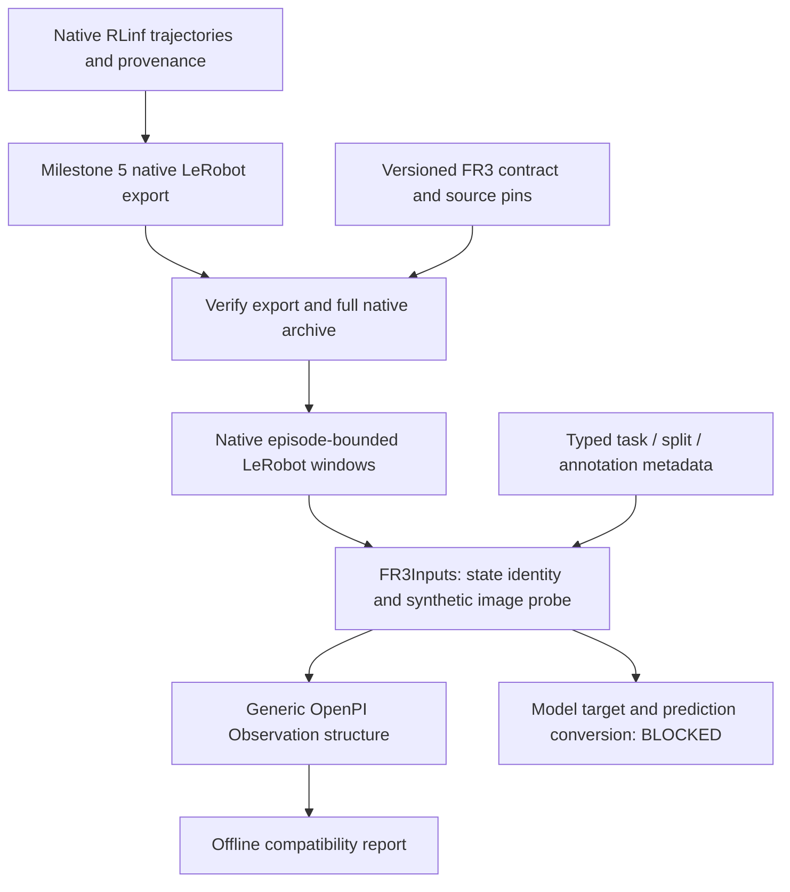

# Milestone 6B — FR3 OpenPI Adapter and Offline Validation

This report describes the working offline FR3 structural adapter, native LeRobot windows, synthetic image preprocessing and typed RECAP metadata. The implementation consumes the existing Milestone 5 bundle and its complete native archive. It produces source-traceable structural samples and a compatibility report while rejecting model targets, prediction-to-controller conversion and checkpoint execution.

**Physical status remains `NO_GO / NOT_GRANTED`.** No training, policy rollout, value-model training, RECAP experiment, physical device acquisition, robot command, controller/NUC change or command ownership was introduced. Synthetic pipeline success is not robot or policy readiness.

## Contract, Versions and Scope

[Milestone 6A](milestone_6a_openpi_recap_contract.md) established and committed `fr3_openpi_structural_v1` before numerical adapter code was implemented. The [contract JSON](../../rlinf/data/datasets/openpi/fr3_contract_v1.json) has canonical SHA-256 `e731df69aee38bed82e832f8108f43787a53670e6d621031fbc5ec3565de614c`. The package pin is `rlinf-openpi==0.1.1`, including all 54 inspected Python-file hashes; its complete source-map hash is `2cb921836f35f511ab7fb59c868c56bdfe3f44049c0ada86be0516e69965b647`. Runtime verification rejects a different installation before preprocessing.

The installed wheel contains no Git revision. The separate official reference is OpenPI commit [`215abfb217dbac7d5f1273282331b9b1866c0479`](https://github.com/Physical-Intelligence/openpi/tree/215abfb217dbac7d5f1273282331b9b1866c0479); wheel equivalence to that revision is not claimed. The verified native data API is LeRobot 0.3.3 / format v2.1, with JAX/JAXlib 0.5.3 and NumPy 1.26.4. Preprocessing ran on CPU with `JAX_PLATFORMS=cpu`.

The reference `pi05_franka_state` configuration has a 32D action expert, horizon 20, 200 tokens, discrete state input, Gemma 2B/300M components and quantile normalization. It is not a selected FR3 checkpoint. Its path templates and those in the generic SFT examples do not qualify checkpoint assets. The FR3 collection configuration has no actor/checkpoint binding. Checkpoint identity, actual model-state contract, model target and model horizon remain null under `CHECKPOINT_UNVERIFIED`.

The 19D assertion belongs to `RealworldInputs`, used by `pi0_realworld`, not to universal π₀.₅ architecture. Its current environment layout is width, force, Euler pose, torque and Cartesian velocity. FR3 has normalized closure rather than width, preserves quaternion pose/source frames, and lacks TCP velocity/Jacobian. The adapter therefore preserves its verified 42D representation instead of manufacturing a 19D vector. In discrete-state PI05, tokenization consumes state before `PadStatesAndActions`, and `pad_to_dim` leaves oversized arrays unchanged. Thus a 32D action expert alone does not prove that 42D state text is unsupported; checkpoint statistics, instruction/tokenizer limits and semantic alignment still need evidence.

The environment also contains torch 2.11.0+cu130, datasets 3.6.0, PyArrow 18.1.0, transformers 4.57.6 and `rlinf-transformer-openpi` distribution metadata 4.53.2. The overlapping transformers installation is not qualified for checkpoint execution by this data-only milestone. No weights or tokenizer assets were downloaded to resolve it. An AI assistant prepared the implementation and reports for the human submitter.

## Native Integration Architecture

The adapter extends native data interfaces without replacing the completed collection, replay or validation components. `FR3OfflineDataset` is a Torch `Dataset` over the existing `LeRobotDataset`; `FR3Inputs` follows RLinf's callable `DataTransformFn` protocol and composes with its existing transform helper. The structural configuration is deliberately not registered as a trainable `TrainConfig` or physical environment.



The established path remains synthetic devices → `fr3_offline` → `TrajectoryAccumulator` → `TrajectoryReplayBuffer` → `.pt`/sidecars → native LeRobot export → independent reload. The new loader first runs the existing export audit, including native archive hashes and Milestone 5 semantic validation. It then opens LeRobot with native action `delta_timestamps`, verifies episode boundaries, binds metadata and applies the FR3 transform. It neither constructs an environment nor starts a collector.

| Added or Modified File | Responsibility |
|---|---|
| `rlinf/data/datasets/openpi/fr3_contract_v1.json` | 6A versioned contract, exact source pins, representations, allowed fixture operations and gates |
| `rlinf/data/datasets/openpi/fr3_contract.py` | Contract fingerprint/source verification; native normalization fixture checks |
| `rlinf/data/datasets/openpi/fr3.py` | Structural config, audited native loader, episode windows and explicit split selection |
| `rlinf/models/embodiment/openpi/policies/fr3_policy.py` | Lossless state/request transform, image probe and permanently rejecting output interface |
| `rlinf/data/datasets/recap/fr3_metadata.py` | Typed task/policy/intervention/frame/outcome schemas and episode binding validation |
| `toolkits/realworld_check/qualify_fr3_openpi.py` | Separate-output offline compatibility CLI |
| `tests/unit_tests/test_data.py` | 58 new data/metadata/normalization/window/guard cases |
| `pyproject.toml` | Include the frozen contract JSON in installed RLinf wheels |
| EN/ZH `guides/fr3_ros2_observation.rst` | Matching usage, interpretation and qualification boundaries |
| `milestone_6a_openpi_recap_contract.md`, this report and evidence JSON | Contract audit, implementation assessment and measured results |

Generic `RealworldInputs`, `FrankaEEOutputs`, model factories, the recorder, environment, replay buffer and Milestone 5 validator/export implementation are unchanged. This checkout has no CI path-filter workflow to extend. Existing directories already have `__init__.py` files; optional OpenPI/LeRobot/JAX data operations are imported where used.

## State and Action Semantics

The state transformation is `lossless_float32_identity_v1`, exactly **42 → 42**. Native slices, joint order, units and source frames are fixed by 6A. Validate exact field order, seven joint names, float32 shape, finite values, normalized closure and unit xyzw quaternion. The transform also reconstructs the ordered dense vector from named native observations and checks exact equality. Permuting values while retaining the field labels fails.

All original joint positions/velocities/efforts, base/stiffness wrenches, raw knuckle angle, closure and pose remain available. No field is omitted or converted. TCP velocity, Jacobian, calibrated width/force and qualified physical transforms stay unavailable. `native_state` and `state` are detached copies; the latter describes the structural observation, not a certified checkpoint input. The checkpoint-facing state dimension remains null.

| Representation | Adapter Behavior |
|---|---|
| Operator request | Original raw input, scripted interpretation and provenance retained under `provenance.operator_request` |
| Recorded controller request | Exact seven float32 values in `recorded_controller_requests[H,7]`; original typed envelopes and mock outcome retained |
| Model training target | `model_training_target = null` |
| Predicted model action | `predicted_model_action = null`; `FR3Outputs` always raises `CHECKPOINT_UNVERIFIED` |
| Future controller request | No constructor, transport, publisher, action client or dispatch path exists in the adapter |

The first window action is checked against the current typed request, and every window action is checked against its original in-episode request. Six arm channels remain normalized FK-relative pose offsets in `[-1,1]`, with the audited 0.007 m / 0.03 rad interface identity and distinct translation/right-multiplied rotation frames. Gripper closure remains absolute normalized `[0,1]`. Identity checks do not multiply by those scales or turn requests into physical execution. No delta, Euler/quaternion, gripper-width or absolute-pose conversion is implemented.

## Images and Language

Both cameras retain their native identity and pixels. LeRobot's CHW float decode is converted back to HWC uint8 and matched to native pixel hashes. `raw_images` preserves these exact images. OpenPI's pinned `ResizeImages(224,224)` produces the structural probe; `Observation.from_dict` performs its native uint8-to-float32 `[-1,1]` conversion. The tests verify image association, dimensions, pixel scaling and source immutability.

| Structural Model Slot | Explicit Fixture Routing | Mask |
|---|---|---|
| `base_0_rgb` | D435i from `image` | True Boolean scalar array |
| `left_wrist_0_rgb` | D405 from `extra_view_image` | True Boolean scalar array |
| `right_wrist_0_rgb` | Declared unused slot, synthetic black padding | False Boolean scalar array |

These names are required by the generic observation structure and establish no physical base/wrist role. Physical camera roles remain null. Changing them to a claimed calibrated role, swapping source pixels or omitting a recorded camera fails. The unused slot is explicit masked padding, not a fabricated camera measurement.

Authentic task text was not recorded in Milestone 4. The derived LeRobot validation label is therefore ignored as a training instruction; `prompt` remains null. A typed synthetic instruction may be retained as external test metadata, but is not promoted into the prompt. Claiming a new annotation is the missing original instruction is rejected. No tokenizer is constructed and no prompt tokens are fabricated. `Observation.from_dict` can validate this generic structure with missing tokenized prompt fields; that is an interface check, not a runnable checkpoint input.

## Action Windows and Normalization

Action sampling reuses LeRobot 0.3.3 `delta_timestamps` at the native logical frequency. Its endpoint-clamping behavior is retained with `actions_is_pad`, `source_frame_indices`, original logical source timestamps, episode ID/index and clock identity. Every non-padded interval must equal the declared period. Padded values repeat the final in-episode request and retain its actual source timestamp; they do not claim a future acquisition.

| Structural Horizon | Original Episodes / Frames | Padded Windows | Padded Elements | Cross-Episode Samples |
|---|---:|---:|---:|---:|
| 1 | 2 / 8 | 0 | 0 | 0 |
| 4 | 2 / 8 | 6 | 12 | 0 |
| 20 | 2 / 8 | 8 | 140 | 0 |
| 50 | 2 / 8 | 8 | 380 | 0 |

The supported inspection range is integer 1–1000. `require_full_window_v1` instead rejects a window missing future actions. Unknown policies, invalid horizons, native timestamp inconsistencies, altered action values or incorrect masks fail. The reference model horizon 20 is source-verified, but **no FR3 checkpoint horizon is selected**. No boundary loss mask or padded target is silently fed to a model.

The normalizer utility uses the installed `Normalize`/`Unnormalize`, requiring `synthetic_math_only` provenance, contract identity, exact state/action statistics, finite values, positive standard deviations and increasing quantiles. Tests check both z-score and quantile formulas and inverses, including OpenPI's `1e-6` constants. Inputs remain unchanged. The CLI's optional fixture uses declared zero/unit statistics to test mathematics; it neither estimates statistics from the eight frames nor produces physical/checkpoint assets. Controller normalization, dataset/model normalization and output denormalization remain distinct. The actual normalization gate is `UNQUALIFIED_NO_CHECKPOINT_ASSETS`.

## RECAP Metadata and Splits

`fr3_recap_metadata_v1` is implemented with frozen typed records: `AnnotationProvenance`, `TaskIdentity`, `PolicyIdentity`, `Intervention`, `FrameAnnotation`, `Outcome` and `EpisodeMetadata`. JSON parsing requires known fields and the versioned document schema. Every record binds to the dataset ID, original manifest SHA-256, native episode ID, frame bounds and original provenance path.

| Metadata | Validation and Current Default |
|---|---|
| Task/instruction | Nonempty task ID/text/version/origin and provenance when supplied; original instruction unavailable, default null |
| Split | Unassigned/train/validation/test; duplicate episode identities across splits rejected; default unassigned |
| Source type | Synthetic demonstration, human demonstration, policy rollout, correction or offline replay represented distinctly; current synthetic source may only be synthetic demonstration/offline replay |
| Policy/rollout | Checkpoint and configuration SHA-256, rollout ID and iteration required together; current dataset defaults null and rejects invented policy-rollout identity |
| Interventions | Operator, reason, exclusive frame interval and annotation provenance; none assigned by default |
| Reward/return/advantage | Explicit finite frame labels and provenance; no native unscored zero is promoted into these labels |
| Outcome/success | Attributed success/failure/unscored label with matching Boolean/null; default null |
| Execution provenance | False physical execution, acceptance unavailable and retained native journal association; metadata cannot grant authority |

`--annotations` reads a separate document; it never modifies the bundle. `metadata_document()` returns a detached explicit skeleton, also included in the report. Synthetic test labels require synthetic provenance. The default report has two missing task instructions, two unassigned splits, and no policy/intervention/outcome/reward-return-advantage annotations. The metadata schema passes while experimental readiness remains unqualified.

`--split` selects only whole episodes explicitly assigned to that split. Tests assign one synthetic episode to train and one to test and verify disjoint four-frame selections. Selecting an empty/unassigned training split fails rather than assigning data implicitly. These assignments are schema fixtures, not an experimental dataset split recommendation.

Existing RECAP reward/return sidecars and advantage/value-model loaders remain unchanged. No return, advantage, success or intervention is calculated or inferred. This milestone does not register FR3 as a trainable RECAP embodiment because its model semantics remain unresolved.

## Reproduce the Offline Qualification

The original Milestone 5 bundle at `/tmp/fr3-milestone5-final/export` was present. Its native archive refers to the original two four-step synthetic episodes, manifest SHA-256 `7101f7c37cf402e1f01ce54bc31072a9500df47aa32168d8f982d7584148b220`. Source and bundle hashes were checked without modification. If these temporary files expire, use the documented Milestone 4 offline recorder and Milestone 5 exporter in new directories; never substitute a physical collection command.

Run the compatibility CLI from the fresh repository in the qualified Python environment:

```bash
JAX_PLATFORMS=cpu PYTHONPATH="$PWD" HF_HUB_OFFLINE=1 \
  HF_DATASETS_CACHE=/tmp/fr3-milestone6-hf-cache \
  python -m toolkits.realworld_check.qualify_fr3_openpi \
  --export /tmp/fr3-milestone5-final/export \
  --output /tmp/fr3-milestone6-final --horizon 4 \
  --check-normalization-fixture
```

The command returned zero and wrote `qualification.json` after auditing all eight transitions and 16 original camera images. Zero means structural inspection completed; the printed checkpoint/state/action/normalization/physical gates remain unqualified. Output must be new and separate from the input. Invalid datasets, contracts, annotations, windows or source installations return nonzero and preserve diagnostics. There is no model execution or physical enable flag.

Reproduce the horizon matrix in the same CPU/offline environment:

```bash
JAX_PLATFORMS=cpu PYTHONPATH="$PWD" HF_HUB_OFFLINE=1 \
  HF_DATASETS_CACHE=/tmp/fr3-milestone6-hf-cache python - <<'PY'
from rlinf.data.datasets.openpi.fr3 import FR3DatasetConfig
from toolkits.realworld_check.qualify_fr3_openpi import qualify_fr3_dataset
for horizon in (1, 4, 20, 50):
    report = qualify_fr3_dataset('/tmp/fr3-milestone5-final/export',
                                config=FR3DatasetConfig(action_horizon=horizon))
    assert report['structural_validation_complete'], report['diagnostics']
    print(report['windows'])
PY
```

The [committed evidence](evidence/milestone_6_openpi_recap_qualification.json) retains the primary CLI result, horizon results, source/configuration identities, metadata skeleton, environment versions, implementation hashes and observed test summary. Additional verification fields describe those explicit audit commands and test runs; they do not change the underlying compatibility decisions.

## Test Results and Diagnostics

All applicable robotics/environment/data regressions ran on CPU. The full data suite includes 58 new cases, bringing the Milestone 5 baseline of 222 to 280 passing tests. No new manual exclusion was added.

| Check | Actual Result |
|---|---|
| Robotics | 495 passed, same 8 placement tests deselected |
| Environment | 280 passed, same 18 placement tests deselected, one existing deprecation warning |
| Applicable data | 280 passed, same one unrelated VLM test deselected; 116 dependency deprecation warnings |
| Focused OpenPI/RECAP tests before final split case | 57 passed; final split-selection case included in the full passing data run |
| Existing lightweight OpenPI/APX/value-model helpers | 14 passed; one pre-existing optional skip: test imports unavailable `transformers.Gemma3ForCausalLM` as a module; 46 unrelated tests unselected |
| Known VLM case, independently rerun | Failed unchanged: installed `VideoMetadata.__init__` rejects `frames_indices`; no VLM source changed |
| End-to-end compatibility | Two native episodes / eight frames, exact archive/pixel associations, horizons 1/4/20/50, explicit padding and typed metadata passed |
| Ruff, formatting, package/import, configuration and whitespace | Scoped checks passed |
| EN/ZH Sphinx and changed-guide markup/symbol checks | Both builds passed with zero warnings; scoped markup/symbol checks passed |
| Offline wheel package | Built without dependencies/network; frozen contract JSON and all four new Python runtime modules match the checkout; independent unpacked imports and contract load passed |

Failure cases cover incorrect feature/value/joint order, missing features, 19D/32D assumptions, invalid quaternions, wrong action kind/absolute semantics/closure range, unverified frame conversion, camera role/pixel swaps, nonfinite values, mask/horizon errors, short windows, modified timestamps, normalization asset/provenance errors, split leakage, missing/malformed metadata, invented original instructions, source reclassification, unknown policy/checkpoint identities, contract/source changes, physical-execution claims and output/source mutation.

A separate-process CLI test forbids physical SDK imports, Ray initialization, process discovery and arbitrary worker launches. It permits only the existing read-only CPU metadata helpers `lscpu` and `uname -p`; preprocessing runs on CPU. It verifies the generic OpenPI structure without model construction, and compares source hashes before/after. No physical-device test or policy-performance result is claimed.

Reproduce the applicable checks:

```bash
PYTHONPATH="$PWD:$PWD/tests/unit_tests" pytest -q tests/unit_tests/test_robotics.py -m 'not placement'
PYTHONPATH="$PWD:$PWD/tests/unit_tests" pytest -q tests/unit_tests/test_real_env.py -m 'not placement'
JAX_PLATFORMS=cpu HF_HUB_OFFLINE=1 HF_DATASETS_CACHE=/tmp/fr3-milestone6-test-cache \
  PYTHONPATH="$PWD:$PWD/tests/unit_tests" pytest -q tests/unit_tests/test_data.py \
  -k 'not test_vlm_trend_batch_video_metadata_stays_nested_per_sample' -m 'not placement'
JAX_PLATFORMS=cpu HF_HUB_OFFLINE=1 PYTHONPATH="$PWD:$PWD/tests/unit_tests" \
  pytest -q -rs tests/unit_tests/test_models.py -k 'openpi or apxinf or value_model' -m 'not placement'
ruff check --preview rlinf/data/datasets/openpi/fr3.py rlinf/data/datasets/openpi/fr3_contract.py \
  rlinf/data/datasets/recap/fr3_metadata.py rlinf/models/embodiment/openpi/policies/fr3_policy.py \
  toolkits/realworld_check/qualify_fr3_openpi.py tests/unit_tests/test_data.py
ruff format --check rlinf/data/datasets/openpi/fr3.py rlinf/data/datasets/openpi/fr3_contract.py \
  rlinf/data/datasets/recap/fr3_metadata.py rlinf/models/embodiment/openpi/policies/fr3_policy.py \
  toolkits/realworld_check/qualify_fr3_openpi.py tests/unit_tests/test_data.py
PYTHONPATH="$PWD" python -m toolkits.realworld_check.validate_fr3_config
python tests/unit_tests/check_missing_init.py
PIP_DISABLE_PIP_VERSION_CHECK=1 PIP_CACHE_DIR=/tmp/fr3-milestone6-pip-cache \
  python -m pip wheel --no-deps --no-build-isolation --no-index . --wheel-dir /tmp/fr3-milestone6-wheels
UV_CACHE_DIR=/tmp/fr3-milestone6-uv-cache python .agents/skills/docs-check/build_docs.py --venv /tmp/fr3-m2a-docs-venv
/tmp/fr3-m2a-docs-venv/bin/python .agents/skills/docs-check/check_rst_markup.py \
  docs/source-en/rst_source/guides/fr3_ros2_observation.rst docs/source-zh/rst_source/guides/fr3_ros2_observation.rst
/tmp/fr3-m2a-docs-venv/bin/python .agents/skills/docs-check/check_doc_symbols.py \
  docs/source-en/rst_source/guides/fr3_ros2_observation.rst docs/source-zh/rst_source/guides/fr3_ros2_observation.rst
git diff --check
```

## Remaining Gates and Next Milestone

6A is complete as a pinned source/representation contract with explicit unknowns. 6B is complete for native loading, lossless structural state/request mapping, synthetic image preprocessing, native temporal windows/masks, normalization mathematics, typed metadata and compatibility reporting. It does not qualify semantic checkpoint state/action targets, authentic language, camera roles/calibration, model normalization assets, tokenizer behavior or checkpoint execution.

Recommended Milestone 7 is an offline checkpoint/asset qualification: choose an immutable checkpoint/configuration, verify its complete training state/action schema and tokenizer/normalization assets, then decide whether a principled FR3-specific training representation is possible. Define original instruction/configuration capture and RECAP annotation/split provenance before any experiment. Verify padding/loss-mask behavior for that exact target. Do not repurpose generic absolute-pose or legacy 19D transforms as a shortcut.

Physical qualification independently still requires frame/TCP/tool and gripper calibration, camera roles/profiles/extrinsics, a verified operator-input mapping, real acquisition freshness, clock/network bounds, exclusive authority and handover, stop/failure/recovery procedures, safeguards, prior abort resolution and named operator authorization. These are outside the synthetic evidence.

Stop after this milestone. No training, RECAP experiment or physical commissioning starts automatically. Physical execution remains **`NO_GO / NOT_GRANTED`**.
