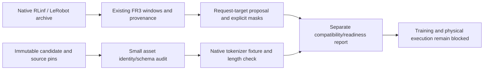

# Milestone 7 — FR3 Checkpoint and Training-Asset Qualification

This report qualifies the official OpenPI `pi05_base` candidate as far as its published source, immutable object metadata and small assets permit. The offline implementation checks those identities, exercises the real tokenizer, prepares explicit request-imitation schema proposals and reports the remaining training requirements. It preserves the native 42D state, seven recorded request channels, full provenance archive and Milestone 6 execution guards.

**Physical execution remains `NO_GO / NOT_GRANTED`.** No weights were downloaded, model constructed, training launched, rollout performed, RECAP experiment run or physical device accessed. A successful inspection does not qualify a checkpoint, dataset or robot for execution. An AI assistant prepared this change for the human submitter.

## Baseline and Candidate Identity

The local and remote fresh branch started clean at `0dafbec562660b6e8f665eedd83d0899762f2888`. The [6A source contract](milestone_6a_openpi_recap_contract.md), [6B implementation](milestone_6b_fr3_openpi_adapter.md), [6 evidence](evidence/milestone_6_openpi_recap_qualification.json), native loader, FR3 input/output transform and RECAP metadata were reviewed. Older experimental branches were not inspected. Upstream searches for `FR3 OpenPI checkpoint` found no overlapping PR or issue.

The official [checkpoint table](https://github.com/Physical-Intelligence/openpi/blob/215abfb217dbac7d5f1273282331b9b1866c0479/README.md#model-checkpoints) lists base, DROID and LIBERO π₀.₅ models. Choose the base for investigating future FR3 fine-tuning: a DROID/LIBERO expert would introduce its own embodiment/task assumptions. This choice does not assign the base a universal robot state/action schema.

| Identity | Verified Value and Limit |
|---|---|
| Candidate URI | `gs://openpi-assets/checkpoints/pi05_base` |
| Immutable generation-set ID | `pi05_base_gcs_generation_set:a8116db1d3a556f5c0b77f3c50950d38a22c7b3fac06ad8a0782f19b4948c633` |
| Frozen inspection contract | `fr3_pi05_candidate_v1`; canonical JSON SHA-256 `b194c9682975f96fe2573928056a1f47ce87986ab8155cc96073ab1e25b8b634` |
| Object inventory | 29 objects, 12,441,749,581 bytes; every object has its exact generation, size and CRC32C; MD5 where supplied by GCS |
| Inspected bytes | 4,298,682 bytes: tokenizer, Franka/DROID statistics, Orbax tree/checkpoint metadata and array shapes |
| Weight format | JAX Orbax / OCDBT. Weight chunks were not fetched, restored, converted or independently checksummed. |
| Official source | [`215abfb217dbac7d5f1273282331b9b1866c0479`](https://github.com/Physical-Intelligence/openpi/tree/215abfb217dbac7d5f1273282331b9b1866c0479); immutable README, configuration, model, tokenizer, loader, normalization guidance and license files inspected |
| Local implementation | `rlinf-openpi==0.1.1`; all 54 Python source hashes still match Milestone 6, source-map SHA-256 `2cb921836f35f511ab7fb59c868c56bdfe3f44049c0ada86be0516e69965b647` |

The generation-set digest identifies the canonical locked object records, not a SHA-256 of downloaded model weights. A mutable bucket prefix alone is insufficient. The [candidate JSON](../../rlinf/data/datasets/openpi/fr3_pi05_candidate_v1.json) pins the complete generation set and small-file SHA-256 values. Access to a deleted historical generation is not guaranteed; substitution with a newer generation must fail. Official source hashes describe the retrieved UTF-8 source snapshots; wheel equivalence to the official Git revision is not claimed.

## Architecture, Configuration and Weight Loading

The small Orbax array metadata contains 51 arrays. Action input/output kernels have shapes `[32,1024]` and `[1024,32]`; the language embedding has shape `[257152,2048]`; a continuous-state projection is absent. Those shapes support the PI05 source architecture with Gemma 2B, a Gemma 300M action expert and 32 action channels. The source configuration uses bfloat16 computation and a 200-token limit. Metadata inspection does not verify saved tensor contents/dtypes or successful loading of all parameters.

The current RLinf reference `pi05_franka_state` specifies discrete state and horizon 20. The installed `Pi0Config(pi05=True)` defaults to horizon 50. Official fine-tuning examples use the same base with other horizons, including 10 and 16. Horizon is a runtime sequence length rather than a learned action-projection dimension. The published object set contains no complete embedded training configuration from which the exact pretraining horizon or full embodiment mixture can be recovered. The report therefore preserves `pretraining_horizon = null`; **20 is an explicitly identified inspection reference**, not a recovered checkpoint training requirement.

Native RLinf `get_model` requires converted `model.safetensors` or an RLinf full checkpoint. It cannot directly load this JAX directory through that path. The official conversion script and source loaders were inspected, but conversion was not run. An immutable conversion recipe, source-to-output tensor audit and independent converted-weight hash are prerequisites for a later model-loading milestone. The existing overlapping transformers distributions (4.57.6 and `rlinf-transformer-openpi` metadata 4.53.2) remain an unqualified model-runtime environment.

## State and Action Qualification

The original state remains a float32 **42 → 42** identity with the feature order, units, joint order, quaternion and source frames fixed by Milestone 6. Native normalization, preprocessing or model declarations cannot silently turn it into the legacy 19D adapter or a 32D vector.

| Representation | Qualification |
|---|---|
| Original 42D state | Native schema and preservation verified |
| Default `Pi0Config.inputs_spec` state | Declares `[B,32]`; the retained `[B,42]` does not satisfy that strict default declaration |
| PI05 discrete-state pathway | Source tokenizes the state before padding and skips the continuous state suffix. A 42-value bounded synthetic state fits the tested token budget; this does not establish pretrained semantics or every instruction's token length. |
| Checkpoint-facing FR3 state | Unqualified: no matched 42D normalization/training schema or authentic task instruction |
| Recorded seven actions | Six normalized measured-FK-relative offsets plus absolute normalized closure; unchanged |
| Original base training actions | No single exact FR3-compatible target schema recovered from this multi-embodiment checkpoint |
| Future FR3 request-imitation proposal | Explicit identity mapping of the seven validated recorded requests; source traceable, synthetic schema only |

The source [normalization guide](https://github.com/Physical-Intelligence/openpi/blob/215abfb217dbac7d5f1273282331b9b1866c0479/docs/norm_stats.md) describes seven joint channels plus a gripper for Franka, with DROID joint-velocity and non-DROID joint conventions. Its detailed action-space section explicitly covers older `pi0_base`/`pi0_fast_base`. Although actual `pi05_base` Franka/DROID statistics are both 8D, their presence does not recover every π₀.₅ pretraining target's absolute/delta, frame, calibration and timing details. Numeric statistics cannot prove those meanings. Do not infer a six-axis pose-offset target from the `franka` name or small action means.

`build_fr3_request_target_proposal` defines `fr3_request_imitation_proposal_v1`. It obtains samples through the audited `FR3OfflineDataset`, preserves the first seven request channels exactly and uses native `PadStatesAndActions(32)` for 25 explicit zero padding channels. State stays 42D because the pinned padding helper leaves oversized arrays unchanged. The result is named `proposed_actions`, retains `model_training_target = null`, applies no normalization, and exposes an explicit per-element mask. This is a prospective new fine-tuning target, not a claim about the original base targets.

The proposal would imitate operator/controller requests, never verified executed poses or grasps. Translational/rotational scales remain 0.007 m / 0.03 rad representation identities; no numerical scale, absolute-pose, velocity, delta-action, rotation or gripper-width conversion is applied. The current synthetic scripted requests establish no useful task-learning evidence. Both original `FR3Outputs` and `require_model_ready`, plus the new `require_fr3_training_ready`, continue to reject execution. No prediction-to-controller path exists.

## Tokenizer, Normalization and Cameras

The tokenizer is `gs://big_vision/paligemma_tokenizer.model`, generation `1711547605575873`, 4,264,023 bytes, SHA-256 `8986bb4f423f07f8c7f70d0dbe3526fb2316056c17bae71b1ea975e77a168fc6`. SentencePiece 0.2.2 reports vocabulary size 257,152, consistent with the checkpoint embedding metadata. Set `OPENPI_DATA_HOME` to its verified local asset root; the probe checks presence, size and hash before constructing the native tokenizer. Missing files cannot trigger an automatic download through this entry point.

The native PI05 format cleans underscores/newlines, discretizes state into 256 bins and constructs task/state/action-prefix text before adding BOS and padding. The new preflight compares the full encoded length with 200 and rejects truncation, which the native tokenizer otherwise permits with a warning. The explicit zero-state/text fixture uses **184 tokens** and produces int32 `[200]` tokens with a Boolean mask. The fixture is separate from the dataset prompt; no derived validation label or fixture text becomes an original instruction. Finite float32 `[42]` fixture state must lie in `[-1,1]`; this restriction does not silently clip real data or qualify future normalization/outlier handling.

The actual candidate assets `assets/franka/norm_stats.json` and `assets/droid/norm_stats.json` each contain mean, std, q01 and q99 vectors of length **8 for state and 8 for action**. Small-file identities, finite values, positive std and increasing quantiles passed. Their dimensions and semantics are incompatible with 42D FR3 observations and seven pose-offset/closure requests. They are inspected and rejected for reuse, not sliced or broadcast into FR3 statistics.

PI05's data factory selects quantile normalization; native z-score/quantile/inverse mathematics remains covered by Milestone 6 regressions. Controller channel normalization is not statistical normalization. Future FR3 assets must be calculated from the approved **training split only**, after the exact state/target transform, and bind dataset/episode hashes, feature order, units/frames, transform version, calculation code/configuration, method, sample counts and checkpoint association. Validation/test data must not contribute. No statistics were computed from the eight-frame fixture or promoted to training assets. Quantile outliers, state token discretization and any clipping policy still need an explicit target contract.

Camera preparation remains the verified synthetic probe: D435i → first model slot, D405 → second, unused third slot false-masked; native OpenPI letterboxing to 224×224 and uint8-to-float32 `[-1,1]`. Model slot names do not qualify base/wrist roles. Physical roles, profiles, calibration and mounting transforms remain unknown.

## Windows, Masks and Native Training Limits

The new proposal reuses Milestone 6 LeRobot windows, source indices, logical timestamps and endpoint masks. It never queries across episodes. The proposal's loss mask enables only the seven original channels at actual, non-padded source steps; all extra channels and repeated future endpoints are false. `require_full_window=True` rejects missing future actions. No record is discarded or repaired.

For the horizon-20 inspection, all eight windows are short: **0 full windows, 140 padded future steps and 140 valid proposed loss elements**. Four-step episodes cannot establish a full horizon-20 target. Horizons 1, 4, 20 and 50 were tested at every original transition, including source identity, value preservation, masking and immutability; Milestone 6 also covers horizon 2 and invalid window/timestamp cases.

The official JAX loss averages action channels, and native RLinf SFT reduces its per-element loss with a mean. Its optional action-chunk setting slices uniform dimensions/time positions; it does not consume per-sample `actions_is_pad`. The new model-helper regression demonstrates that padded values still affect both existing reductions. Returning a correct mask does not wire it into a loss. A later authorized implementation must either integrate and test a per-sample mask through collation, worker batching and loss reduction, or explicitly select/audit only complete windows. Neither solution is silently activated here. Masking the 25 new channel pads is also a proposed FR3 training decision, not a recovered pretrained loss policy.

## Training Metadata and RECAP Requirements

The versioned `fr3_training_requirements_v1` assessment extends the existing metadata checks without replacing `fr3_recap_metadata_v1`. It binds the dataset, source manifest, episode records and newly selected candidate, and distinguishes archived facts from future collection requirements.

| Required Provenance | Current Fixture | Future Record |
|---|---|---|
| Original instruction/task | Missing; two episodes unannotated | Exact original instruction, task ID/version/origin and annotation provenance bound to episode |
| Collection session | Only arm/gripper authority sessions exist | Explicit collection-session ID, recorder/device/software/configuration identities; authority sessions retained separately |
| Camera configuration | Synthetic identities and pixels; physical configuration unqualified | Immutable profile/role/calibration/configuration record, source identity and timestamps |
| Observation/action schema | Both version 1 archived and validated | Preserve full versions, fields, units/frames and typed request/execution provenance |
| Resolved configuration | Hash and complete native archive preserved | Immutable resolved configuration plus hash and collection binding |
| Dataset split | Both episodes unassigned | Explicit episode-level train/validation/test assignment and assignment provenance |
| Normalization | FR3 training assets absent | Training-split-only statistics and complete transformation/calculation provenance |
| Checkpoint association | Offline candidate chosen after collection | Generation-set/converted-weight/configuration hashes; never invent a policy used during collection |
| RECAP experiments | No rollout/outcome/intervention/reward/return/advantage evidence | Existing typed policy, rollout, annotation and outcome contracts with actual evidence |

Missing instructions, task identities, collection sessions, physical camera configuration, split and normalization provenance are each reported for both episodes. Existing authority IDs are not renamed as collection-session IDs. The assessment never manufactures rewards, advantages, success labels or policy association. No FR3 trainable `TrainConfig` or RECAP sidecar is registered.

## Offline Implementation and Reproduction

The implementation adds the candidate JSON, `rlinf/data/datasets/openpi/fr3_training.py` and `toolkits/realworld_check/qualify_fr3_checkpoint.py`. It extends data/model tests, includes the new JSON in wheel package data, adds this report/evidence and updates the EN/ZH observation guides. Generic transforms, native loss/loader behavior, recorder, robot environments and old frozen FR3 contract are unchanged.



The asset root lives on `/tmp`, outside the home filesystem. To reproduce the bounded small-asset acquisition, read the frozen contract and fetch only its explicitly inspected objects and tokenizer. The command below does not fetch any weight chunks and checks all sizes/hashes before writing:

```bash
python - <<'PY'
import hashlib, json, urllib.parse, urllib.request
from pathlib import Path
c = json.loads(Path('rlinf/data/datasets/openpi/fr3_pi05_candidate_v1.json').read_text())
root = Path('/tmp/fr3-milestone7-assets')
entries = [o for o in c['objects'] if o.get('downloaded_for_inspection')] + [c['tokenizer']]
for o in entries:
    assert o['size'] < 5_000_000
    p = root / o['bucket'] / o['name']
    if p.exists():
        data = p.read_bytes()
    else:
        url = ('https://storage.googleapis.com/storage/v1/b/' + o['bucket'] + '/o/'
               + urllib.parse.quote(o['name'], safe='') + '?alt=media&generation=' + o['generation'])
        with urllib.request.urlopen(url, timeout=40) as response:
            data = response.read(o['size'] + 1)
    assert len(data) == o['size'] and hashlib.sha256(data).hexdigest() == o['sha256']
    if not p.exists():
        p.parent.mkdir(parents=True, exist_ok=True)
        p.write_bytes(data)
print('generation-pinned small assets verified; no weights downloaded')
PY
```

Run the inspection against the existing Milestone 5 bundle, using a new separate output directory. This command performs no network fetch:

```bash
OPENPI_DATA_HOME=/tmp/fr3-milestone7-assets JAX_PLATFORMS=cpu HF_HUB_OFFLINE=1 \
  HF_DATASETS_CACHE=/tmp/fr3-milestone7-hf-cache PYTHONPATH="$PWD" \
  python -m toolkits.realworld_check.qualify_fr3_checkpoint \
  --export /tmp/fr3-milestone5-final/export \
  --assets /tmp/fr3-milestone7-assets --output /tmp/fr3-milestone7-final
```

Zero exit status means all permitted inspection steps completed, with checkpoint/training/RECAP readiness still unqualified. Invalid or missing assets, changed candidate/source identities and malformed datasets produce nonzero status and diagnostic JSON. Output must be separate from both input roots and must not already exist. The [committed evidence](evidence/milestone_7_checkpoint_qualification.json) records the actual report and regression/environment checks. If the temporary dataset expires, regenerate only through the documented Milestone 4 hardware-inaccessible synthetic collector and Milestone 5 exporter into new directories.

## Verification and Remaining Gates

The tests cover candidate tampering, missing/corrupted/symlinked assets, incompatible statistics, tokenizer dimensions/range/dtype/length/cache, proposal preservation and masks, strict windows, missing metadata, output overlap, source immutability and diagnostics. An independent CLI process forbids network connections, hardware SDKs, model construction, Ray initialization, process discovery and arbitrary worker launches; only existing read-only CPU metadata commands are permitted. Optional asset tests explicitly skip when `FR3_PI05_ASSET_ROOT` is absent; the recorded qualification run supplies the exact assets and does not skip them.

The final CPU regressions passed with the same manual exclusions as Milestone 6. All new small-asset tests ran with the pinned assets present.

| Check | Actual Result |
|---|---|
| Robotics | 495 passed; 8 existing placement exclusions |
| Environment | 280 passed; 18 existing placement exclusions; one existing warning |
| Data | 312 passed, including 32 new cases; one existing VLM exclusion; 116 dependency warnings |
| Model helpers | 15 passed, including one new native-loss test; one pre-existing optional Gemma3 module-import skip; 46 unrelated cases unselected |
| Known VLM case, rerun separately | Failed unchanged: installed `VideoMetadata` rejects `frames_indices`; no VLM code modified |
| Offline CLI and safety guard | Passed; two episodes/eight transitions, six pinned small assets, no network/model/hardware access |
| Ruff, formatting, package/import, configuration, AST and whitespace | Passed; offline wheel includes the candidate JSON and independent unpacked source/asset checks passed |
| EN/ZH documentation | Both Sphinx builds passed with zero warnings; scoped markup and symbol checks passed |

An initial sandbox run could not create the existing fake-worker IPC socket. The CPU mock regressions were rerun outside that filesystem sandbox without opening hardware. An intermediate data run used the earlier collection-session expectation; the final run above includes the corrected distinction between authority and collection sessions. Neither issue introduced a test exclusion.

Reproduce the scoped checks in the pinned CPU environment:

```bash
PYTHONPATH="$PWD:$PWD/tests/unit_tests" pytest -q tests/unit_tests/test_robotics.py -m 'not placement'
PYTHONPATH="$PWD:$PWD/tests/unit_tests" pytest -q tests/unit_tests/test_real_env.py -m 'not placement'
FR3_PI05_ASSET_ROOT=/tmp/fr3-milestone7-assets OPENPI_DATA_HOME=/tmp/fr3-milestone7-assets \
  JAX_PLATFORMS=cpu HF_HUB_OFFLINE=1 HF_DATASETS_CACHE=/tmp/fr3-milestone7-test-cache \
  PYTHONPATH="$PWD:$PWD/tests/unit_tests" pytest -q tests/unit_tests/test_data.py \
  -k 'not test_vlm_trend_batch_video_metadata_stays_nested_per_sample' -m 'not placement'
JAX_PLATFORMS=cpu HF_HUB_OFFLINE=1 PYTHONPATH="$PWD:$PWD/tests/unit_tests" \
  pytest -q -rs tests/unit_tests/test_models.py -k 'openpi or apxinf or value_model' -m 'not placement'
ruff check --preview rlinf/data/datasets/openpi/fr3_training.py \
  toolkits/realworld_check/qualify_fr3_checkpoint.py tests/unit_tests/test_data.py tests/unit_tests/test_models.py
ruff format --check rlinf/data/datasets/openpi/fr3_training.py \
  toolkits/realworld_check/qualify_fr3_checkpoint.py tests/unit_tests/test_data.py tests/unit_tests/test_models.py
PYTHONPATH="$PWD" python -m toolkits.realworld_check.validate_fr3_config
python tests/unit_tests/check_missing_init.py
PIP_DISABLE_PIP_VERSION_CHECK=1 PIP_CACHE_DIR=/tmp/fr3-milestone7-pip-cache \
  python -m pip wheel --no-deps --no-build-isolation --no-index . --wheel-dir /tmp/fr3-milestone7-wheels
UV_CACHE_DIR=/tmp/fr3-milestone7-uv-cache python .agents/skills/docs-check/build_docs.py --venv /tmp/fr3-m2a-docs-venv
git diff --check
```

The source repository has an [Apache-2.0 license](https://github.com/Physical-Intelligence/openpi/blob/215abfb217dbac7d5f1273282331b9b1866c0479/LICENSE) and separate [Gemma terms](https://github.com/Physical-Intelligence/openpi/blob/215abfb217dbac7d5f1273282331b9b1866c0479/LICENSE_GEMMA.txt). The object set does not embed a model-specific license statement; future model use must resolve applicable weight/inherited terms rather than infer them from anonymous GCS access. Public listing and generation-pinned small-file access required no credentials; this is an access observation, not a license grant.

Milestone 7 completes source/asset qualification and the verified offline probes. Checkpoint execution, semantic state/action compatibility, physical camera inputs, authentic instructions/splits, FR3 normalization, converted-weight verification, native loss-mask integration, experimental RECAP readiness and physical qualification remain unresolved or incompatible as described above.

The next offline training milestone requires an approved FR3 training representation, a real qualified training dataset with original instructions and episode splits, training-only normalization assets, an immutable converted checkpoint/configuration, a verified compatible model environment, token-budget checks and end-to-end padding/loss-mask support or audited full-window selection. Its implementation and any eventual training launch require a separate instruction. Physical frame/TCP/gripper/camera calibration, timing, exclusive authority, safety/recovery procedures and named operator authorization remain independent blockers. Stop here: no training, RECAP experiment or physical commissioning starts automatically.
