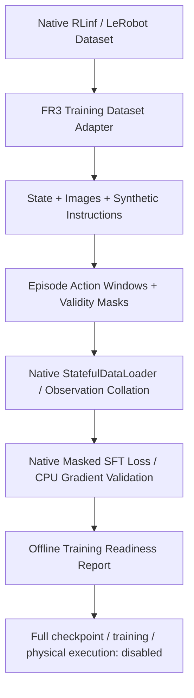

# Milestone 8 — FR3 Training Pipeline Readiness (Offline)

This report describes native FR3 batch preparation, mask propagation and valid-element loss reduction for future OpenPI fine-tuning. It validates the implementation with synthetic datasets, a 32-parameter CPU loss probe and small checkpoint-conversion fixtures. The original 42D state, seven typed requests and complete native archive remain available.

**Training and full-checkpoint execution remain disabled. Physical execution is `NO_GO / NOT_GRANTED`.** No full weights were downloaded or converted, no pretrained model was instantiated, no optimizer was created by the smoke command, and no policy rollout, RECAP experiment or physical device operation occurred. An AI assistant prepared this change for the human submitter.

## Baseline and Native Execution Audit

The local and remote fresh branch started clean at `cd584a203918e38fb20d81dfdb4f20a12cdf8d0f`. The [6A contract](milestone_6a_openpi_recap_contract.md), [6B adapter](milestone_6b_fr3_openpi_adapter.md), [7 qualification](milestone_7_checkpoint_asset_qualification.md), their evidence and actual source implementations were reviewed. Old experimental branches were not inspected. Upstream PR/issue searches for `FR3 OpenPI masked loss` found no overlapping work.

The native SFT entry point is `examples/sft/train_vla_sft.py`, which launches `FSDPVlaSftWorker` and `SftRunner`. The runner calls worker training and checkpoint methods. The following source-level responsibilities explain where this change composes with that workflow; the entry point was inspected, not run.

| Stage | Native Component and Contract |
|---|---|
| Dataset selection | `rlinf/data/datasets/openpi/__init__.py` chooses dedicated BEHAVIOR/dual-Franka loaders or the official LeRobot loader. No FR3 trainable configuration is registered. |
| Official data processing | `official_sft_data_loader.py`, installed `openpi.training.data_loader`, `ModelTransformFactory`, normalization and token/image transforms |
| FR3 source | Existing `FR3OfflineDataset` audits native provenance and export, loads LeRobot, and invokes `FR3Inputs`; the new `FR3TrainingDataset` wraps this path |
| Temporal queries | Native LeRobot `delta_timestamps`, endpoint repeat and `actions_is_pad`; original episode/frame indices and logical timestamps retained |
| Collation | New `collate_fr3_training_items` returns the existing dictionary SFT API with native `Observation`, actions and explicit masks; `StatefulDataLoader` handles iteration/state |
| Worker transfer | `FSDPVlaSftWorker._training_micro_batches` prepares valid-count normalization; `get_train_model_output` passes the entire dictionary to `ForwardType.SFT` |
| Model transfer | `Pi0._observation_to_device`, `_actions_to_device` and Boolean mask transfer preserve shape and identity |
| Loss | `Pi0.compute_loss` returns `[B,H,D]` MSE; optional RLT uses the same per-element VLA reduction and retains its auxiliary weight |
| Accumulation | `FSDPSftWorker.run_training` divides each microbatch loss by G; standard FSDP averages gradients across W ranks |
| Update/save | Existing gradient scaler, `optimizer_step`, zero-grad, LR scheduler and strategy checkpoint saving are unchanged. Stateful loader/RNG save/restore remains in `FSDPVlaSftWorker`. |
| Initialization/assets | Native OpenPI `get_model` loads safetensors or RLinf full weights; normalization assets come from the configured data pipeline. Neither checkpoint loading nor an optimizer update is exercised here. |

The base worker now exposes its existing iterator logic as `_training_micro_batches`. Legacy loaders retain lazy data/forward RNG ordering and the existing arithmetic mean. Only loaders declaring `uses_action_loss_masks` prefetch one accumulation group of CPU batches so their total supervised count is available before backward. This adds bounded CPU buffering for the new path and leaves legacy loaders unchanged.

## Training Schema and Dataset Integration

The packaged [training contract](../../rlinf/data/datasets/openpi/fr3_training_v1.json) defines **`fr3_training_batch_v1`**, independently of the native observation and physical controller schemas. `FR3TrainingConfig` selects `masked_padded_windows` or `require_full_window`, an explicit fixture partition and the pinned local tokenizer assets. It is an offline schema configuration, not a trainable OpenPI `TrainConfig`.

| Batch Field | Shape / Meaning |
|---|---|
| `observation.state` | Float32 `[B,42]`, fixture-normalized in the original feature order |
| `native_state` | Float32 `[B,42]`, exact original values; raw joint units, wrench/pose frames and unit xyzw quaternion preserved |
| `observation.images` | Three `[B,224,224,3]` float32 slots in `[-1,1]`; two synthetic camera streams plus declared unused third slot |
| `observation.image_masks` | Boolean `[B]` per slot; D435i/D405 true, unused slot false |
| `observation.tokenized_prompt` / mask | Integer `[B,200]` / Boolean `[B,200]`, from explicit synthetic fixture text and normalized 42D state |
| `actions` | Float32 `[B,H,32]`; seven fixture-normalized request channels, followed by 25 explicit zeros |
| `valid_action_channels` | Boolean `[B,32]`; first seven true |
| `valid_future_steps` | Boolean `[B,H]`; only original source steps true |
| `action_loss_mask` | Boolean `[B,H,32]`, exact outer conjunction of channel and temporal masks |
| `provenance` | Original per-sample episode/frame identity, source frame indices/timestamps, clock, requests, mock outcomes and observation journal |
| Source/qualification markers | `offline_schema_probe=true`, `physical_execution=false`; checkpoint training target remains unavailable |

Native state feature order, units/frames and unavailable TCP velocity/Jacobian/calibrated jaw width remain those in [6A](milestone_6a_openpi_recap_contract.md). Statistical encoding does not turn normalized quaternion channels into a new physical orientation representation. The raw unit quaternion stays in `native_state` and the archive. No 19D conversion, 42→32 slicing, physical frame conversion or fabricated measurement is introduced.

Actions preserve the source meaning: six dimensionless measured-FK-relative pose-offset requests and absolute normalized Robotiq closure. The 0.007 m / 0.03 rad interface identity remains provenance, not a conversion to SI velocity or absolute pose. Seven meaningful channels plus 25 channel pads are a **prospective request-imitation target**, not verified original `pi05_base` targets. `model_training_target` remains null in source items; full-checkpoint guards and prediction conversion remain disabled.

The wrapper requires versioned `fr3_training_fixture_v1` metadata with explicit synthetic task identity, instruction/version/origin/provenance, manifest binding and whole-episode partitions. It does not edit RECAP annotations or promote the original derived validation label to an instruction. The default smoke fixture assigns episode 0 to synthetic train and episode 1 to synthetic validation; these assignments establish no experimental split readiness.

Collation validates state dimensions/order, action semantics/padding, camera/tensor contracts, token dtype/budget, source frame/timestamp associations and every mask dimension. The dictionary API carries masks and original provenance without passing through the legacy 19D adapter. Real `Pi0.sft_forward` rejects `offline_schema_probe` batches; only the isolated unregistered scalar loss probe accepts them. No training command or loader dispatch bypasses readiness qualification.

## Masked Loss and Gradient Normalization

The new `sft_loss.py` accepts only Boolean masks matching `[B,H,D]`, rejects zero valid supervision and validates finite selected losses. The reduction is:

```text
N = sum(elementwise_loss at valid elements)
D = sum(valid_mask)
masked_loss = N / D
```

`Pi0.sft_forward` transfers the mask to the action device and zeros invalid action inputs before `compute_loss`. This prevents arbitrary padded target values, including nonfinite padding, from entering the network's noised action input. The reduction selects valid loss elements instead of multiplying invalid NaNs by zero. It accumulates the selected numerator in float32. Tests establish zero direct gradients for invalid targets/loss elements and padded output channels in the deterministic probe; they do not claim full-transformer attention activations are independent of every padded token.

One local masked mean per microbatch would weight short windows incorrectly. The native worker's existing `/G` and FSDP's `/W` remain unchanged. The masked worker sums valid counts over all G local microbatches and all W ranks, then supplies each model with:

```text
normalizer = D_global / (W * G)
model_loss_micro = N_micro / normalizer
backward_micro = model_loss_micro / G
FSDP average = sum_over_ranks_and_microbatches(N_micro) / D_global
```

This preserves the valid-element denominator even when ranks/microbatches have different supervision counts. The current native device mesh spans the SFT world in one sharding dimension; count all-reduce uses that complete default process group. The denominator is detached and worker-owned. Masks cannot silently enter a legacy worker path lacking the normalizer. A model called directly with a mask and no worker normalizer uses its local valid-element mean.

Legacy unmasked SFT/DAgger means and action-chunk slicing are unchanged. With a local explicit mask, chunk slicing applies to both mask and loss; a worker-normalized mask plus an additional chunk slice rejects because that would invalidate the precomputed denominator. RLT retains its original auxiliary weighting and reduction; only its masked VLA component uses the new denominator.

CPU tests compare values and gradients against a single global mean with unequal microbatches and two logical ranks. Worker batch methods run without initializing a scheduler/Ray worker. FSDP mesh/group regressions also run on CPU. Full GPU FSDP1/FSDP2 execution, mixed-precision numerical behavior and actual training remain outside this milestone's qualification.

## Episode Windows and Float32 Timing

The short source fixture still has two four-step episodes and eight original transitions. The smoke's explicit train partition contains four frames; the held-out episode is not used for fixture statistics or supervision.

| Horizon | Train Windows | Repeated Future Steps | Valid Loss Elements | Cross-Episode Windows |
|---|---:|---:|---:|---:|
| 1 | 4 | 0 | 28 | 0 |
| 4 | 4 | 6 | 70 | 0 |
| 20 | 4 | 70 | 70 | 0 |
| 50 | 4 | 190 | 70 | 0 |

`masked_padded_windows` keeps endpoint repeats and their original source index/timestamp, with false temporal masks. `require_full_window` explicitly selects only complete windows and exposes excluded source indices in `excluded_full_window_indices`. It rejects an empty selection; the short fixture has no complete horizon-20 window. It never silently repairs missing future measurements.

Additional native synthetic collection/export fixtures contain **two 52-step episodes**. For one explicit training episode, complete-window counts are 52, 49, 33 and 3 at horizons 1, 4, 20 and 50. Excluded incomplete counts are 0, 3, 19 and 49. Source frame indices, masks, timestamps and episode boundaries pass without crossing into the held-out episode.

These longer fixtures exposed an existing LeRobot audit issue: a fixed 1e-7 timestamp tolerance rejected legitimate float32 rounding after a few seconds. Native LeRobot declares `timestamp` as float32. The audit now requires that dtype and compares exactly to the float32 representation of the expected relative time. This tightens serialization checking rather than widening a physical timing tolerance. Logical nanosecond timestamps and the synthetic synchronization contract remain unchanged. Horizon 20 is the inspected reference configuration, not the recovered original pretraining horizon.

## Normalization, Language and Cameras

`fr3_training_normalization_v1` validates dataset/manifest identity, training episode IDs and their split hash, original sample count, state/action feature order and dimensions, transform/checkpoint association, method, attributed statistics provenance, finite values, positive scales and increasing quantiles. The dimensions are exactly 42 state and seven action channels, before action padding. The published 8D Franka/DROID assets remain incompatible.

Current accepted statistics are explicitly `synthetic_math_only`: literal zero means/std 100 or q01/q99 ±100, never estimates from the eight-transition fixture. Native OpenPI `Normalize`/`Unnormalize` mathematics is reused and tested for both methods. The production scope always rejects until an approved real training dataset, split and final transform exist. Evaluation/test episodes cannot enter the declared training statistics. Inputs and archived metadata remain unchanged.

The future workflow must freeze the qualified representation and whole-episode split first, compute statistics from original training frames only rather than repeated action-window endpoints, and store sample counts, feature order/units/frames, source hashes, code/configuration version, clock/provenance and checkpoint binding. Validate/infer with those immutable assets; never recompute statistics from validation/test data. Decide outlier/clipping and quaternion/statistical encoding semantics explicitly before production qualification.

The pinned tokenizer from Milestone 7 runs on actual fixture-normalized 42D state and explicit synthetic instructions. Its full encoded length is checked before native truncation can occur; token masks survive collation. The 200-token budget is not assumed sufficient for future authentic instructions. Images retain D435i/D405 identity, native letterbox resizing and pixel normalization; physical base/wrist roles, profiles, mounting transforms and calibration remain unqualified.

## Immutable Conversion Recipe and Runtime Audit

The candidate remains `pi05_base_gcs_generation_set:a8116db1d3a556f5c0b77f3c50950d38a22c7b3fac06ad8a0782f19b4948c633`. The [official conversion implementation](https://github.com/Physical-Intelligence/openpi/blob/215abfb217dbac7d5f1273282331b9b1866c0479/examples/convert_jax_model_to_pytorch.py) was retrieved at the immutable revision; its snapshot hash, all 51 expected source-array names/shapes and source-to-destination route definitions are in the training contract. All 29 generation-pinned objects are needed for a future complete source snapshot; none of the full weight chunks was downloaded here.

The recipe is Orbax restore → official PaliGemma/SigLIP/Gemma slicing and projection transforms → official PyTorch keys → native `old_to_new_state_dict` → native safetensors loading. Vision uses the documented convolution/attention transposes and reshapes; stacked layer arrays are indexed by layer; expert/VLM weights split by the official suffix rules. Projection kernels transpose and biases retain order. The entire mapping implementation and native loader remain the source of truth; only the projection subset is executed with small synthetic tensors here.

The source audit identified three conversion hazards that must be resolved in a future authorized full conversion: the script branches on `pi05` in the staging path; its `load_state_dict(strict=False)` needs an independent complete missing/unexpected-key audit; and its asset-copy expression uses the checkpoint's parent `assets` directory, whereas this candidate stores assets under its own root. The frozen recipe therefore requires a `pi05_base` staging identity, exact PI05/32D architecture configuration, explicit hash-verified transfer from the actual checkpoint root assets, complete tensor coverage and tied-weight checks, output hashes and independent native loading. YAML/configuration must be frozen separately because native RLinf does not derive its architecture from converted `config.json`.

The 51 array shapes total 3,353,433,872 scalar elements. An fp32 restoration alone requires about 13.41 GB of raw array storage in host memory; bf16 destination payload is about 6.71 GB before format/tied-weight effects. Source objects occupy 12.44 GB. Restored arrays, converted copies, a constructed model and temporary workspaces can coexist, so these are lower bounds, not a verified peak RAM/disk budget. Plan separate source/output/scratch capacity outside home and measure peak use in the future authorized environment. Force CPU placement for an intended CPU conversion; no GPU/memory qualification is claimed. Actual full conversion/loading status is **`WEIGHT_CONVERSION_NOT_EXECUTED`**.

A tiny 3×4 kernel plus four biases exercises the official transpose/identity rule, writes `synthetic_projection_fixture.safetensors` with ineligible-checkpoint metadata, reloads it independently and loads it through native `load_base_safetensors` into a tiny linear module. Its checksum and exact inverse/value comparison pass. This fixture is not a usable or trained OpenPI policy.

The runtime audit reads actual distribution requirements and shared-file ownership. `rlinf-openpi==0.1.1` requires `torch==2.7.1`; installed torch is 2.11.0+cu130. Stock transformers 4.57.6 requires tokenizers ≥0.22, while the installed 4.53.2 OpenPI fork requires <0.22; tokenizers is 0.21.4. Both distributions claim the same transformers paths; the imported module reports version 4.53.2 despite stock distribution metadata reporting 4.57.6. Tiny CPU tests passing does not qualify this environment for full model execution.

The training contract records partial source constraints: Python 3.11, OpenPI 0.1.1, its transformer fork 4.53.2, torch 2.7.1, JAX/JAXlib 0.5.3, Orbax 0.11.13, NumPy ≥1.25,<2, tokenizers ≥0.21,<0.22 and SentencePiece ≥0.2. These are reproducible input constraints, **not a solved environment lock**. A separately isolated environment must reconcile RLinf/LeRobot and accelerator dependencies, ensure a single transformers owner, apply/version the required patches, then pass imports, interface tests and authorized converted-weight loading. No package, CUDA, JAX, machine storage or network configuration was modified. The unrelated VLM `VideoMetadata.frames_indices` failure remains separate.

## Source Evolution, Reproduction and Results

Milestone 7 froze native source hashes before this mask implementation. Its source verifier now permits only the exact reviewed predecessor→successor transition in `fr3_training_v1.json`, and verifies all pinned native loss/worker/data sources. The old candidate and structural JSON contracts remain byte-for-byte unchanged. Arbitrary source changes still fail. Milestone 7's proposal format is not the new masked batch API; its null-target and rejection behavior remains intact.

The scoped files include native `pi0.py`, `sft_loss.py`, base/VLA SFT workers, the existing FR3 source verifier and LeRobot timestamp audit; new `fr3_pipeline.py`, `fr3_checkpoint_audit.py`, training JSON and smoke CLI; data/model tests; package data; this report/evidence and matching EN/ZH guide updates.



The existing Milestone 5 bundle and Milestone 7 small assets were present. Their original manifest identity and source bytes remain unchanged. Run the offline smoke with the existing pinned assets and a new separate output directory:

```bash
OPENPI_DATA_HOME=/tmp/fr3-milestone7-assets JAX_PLATFORMS=cpu HF_HUB_OFFLINE=1 \
  HF_DATASETS_CACHE=/tmp/fr3-milestone8-hf-cache PYTHONPATH="$PWD" \
  python -m toolkits.realworld_check.validate_fr3_training \
  --export /tmp/fr3-milestone5-final/export --assets /tmp/fr3-milestone7-assets \
  --output /tmp/fr3-milestone8-qualified
```

This audits native provenance, fixture metadata/statistics, state/images/tokens, all four horizons, collation, native loss/gradients, runtime constraints and tiny conversion/reload, then writes `readiness.json`. Zero means the permitted software smoke completed, not that training is enabled. If temporary assets expire, use the bounded generation-pinned small-asset recipe in Milestone 7 and the hardware-inaccessible synthetic recorder/export commands in Milestones 4–5; do not substitute a real collection command.

The [machine-readable evidence](evidence/milestone_8_training_readiness.json) preserves the actual smoke result plus test/source/environment verification. Final CPU regressions pass, including 44 new data cases and 16 new model-helper cases. All pinned-asset tests ran with the assets present; no new exclusion was added.

| Check | Actual Result |
|---|---|
| Robotics | 495 passed; same 8 placement exclusions |
| Environment | 280 passed; same 18 placement exclusions; one existing warning |
| Data | 356 passed; same one VLM exclusion; 636 dependency deprecation warnings |
| Model helpers | 31 passed; same one optional Gemma3 module-import skip; 46 unrelated cases unselected |
| FSDP CPU mesh/group | 12 passed |
| Separate known VLM run | Failed unchanged: `VideoMetadata.__init__` rejects `frames_indices` |
| Offline smoke / guarded command | Passed for all four horizons; padded channel gradient maximum 0; no optimizer, full model, network or physical acquisition |
| Packaging/import/configuration | Offline wheel and independent unpacked contract/source-transition imports passed; Hydra offline schema and package initializers passed |
| Ruff/format/whitespace/docs | Scoped checks passed; both Sphinx trees built with zero warnings; guide markup/symbol checks passed |

Intermediate validation caught the float32 timestamp issue described above and a stale verifier constant while expanding the reviewed source profile. Both were corrected; the final profile/source check, focused tests and full suite were rerun. The original datasets and execution guards were preserved throughout.

Reproduce the applicable suites with the same placement/VLM exclusions and optional model-helper skip:

```bash
PYTHONPATH="$PWD:$PWD/tests/unit_tests" pytest -q tests/unit_tests/test_robotics.py -m 'not placement'
PYTHONPATH="$PWD:$PWD/tests/unit_tests" pytest -q tests/unit_tests/test_real_env.py -m 'not placement'
FR3_PI05_ASSET_ROOT=/tmp/fr3-milestone7-assets OPENPI_DATA_HOME=/tmp/fr3-milestone7-assets \
  JAX_PLATFORMS=cpu HF_HUB_OFFLINE=1 HF_DATASETS_CACHE=/tmp/fr3-milestone8-test-cache \
  PYTHONPATH="$PWD:$PWD/tests/unit_tests" pytest -q tests/unit_tests/test_data.py \
  -k 'not test_vlm_trend_batch_video_metadata_stays_nested_per_sample' -m 'not placement'
JAX_PLATFORMS=cpu HF_HUB_OFFLINE=1 PYTHONPATH="$PWD:$PWD/tests/unit_tests" \
  pytest -q -rs tests/unit_tests/test_models.py -k 'openpi or apxinf or value_model' -m 'not placement'
PYTHONPATH="$PWD:$PWD/tests/unit_tests" pytest -q tests/unit_tests/test_fsdp.py
PYTHONPATH="$PWD" python -m toolkits.realworld_check.validate_fr3_config
python tests/unit_tests/check_missing_init.py
PIP_DISABLE_PIP_VERSION_CHECK=1 PIP_CACHE_DIR=/tmp/fr3-milestone8-pip-cache \
  python -m pip wheel --no-deps --no-build-isolation --no-index . --wheel-dir /tmp/fr3-milestone8-wheels
UV_CACHE_DIR=/tmp/fr3-milestone8-uv-cache python .agents/skills/docs-check/build_docs.py --venv /tmp/fr3-m2a-docs-venv
git diff --check
```

The safety test executes the CLI with network connections, full model constructors, optimizers, hardware SDK imports, Ray initialization, process discovery and arbitrary worker launches forbidden. Only read-only CPU metadata commands are permitted. No trained checkpoint is saved; the tensor-conversion artifact is explicitly synthetic and ineligible.

## Separate Readiness Decisions and Milestone 9

Native dataset validity, FR3 batch-schema validity, action-target structure, mask integration and pinned source checks pass within the synthetic software scope. Semantic targets, checkpoint-specific state preprocessing, physical camera roles, original task instructions, approved real episode splits, production normalization, model-runtime compatibility, checkpoint execution and RECAP experimental readiness remain **UNQUALIFIED**. Converted pretrained weights are **NOT_EXECUTED**. Physical authorization remains **`NO_GO / NOT_GRANTED`**; `training_enabled=false` independently of smoke success.

Recommended Milestone 9 is a separately authorized offline checkpoint/runtime qualification: resolve and lock an isolated environment; approve a full immutable weight download/conversion budget and perform complete tensor/key/value/hash audits; test independent native loading without robot transport; qualify the exact FR3 state/action/tokenizer/normalization contract; and exercise distributed backend/mixed-precision mask behavior. An approved real dataset with original instructions, collection-session/camera/configuration records, episode splits and training-only statistics is required before meaningful fine-tuning. Do not automatically launch training, physical qualification or RECAP experiments.
